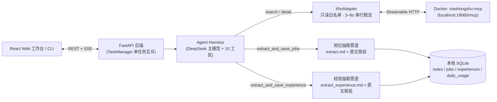
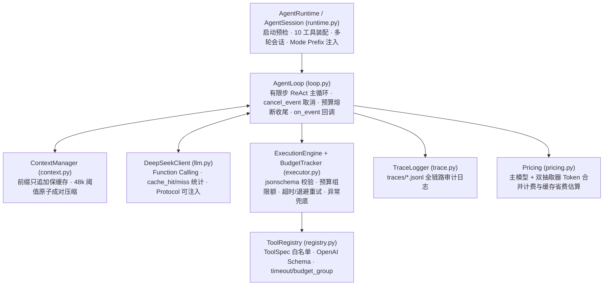
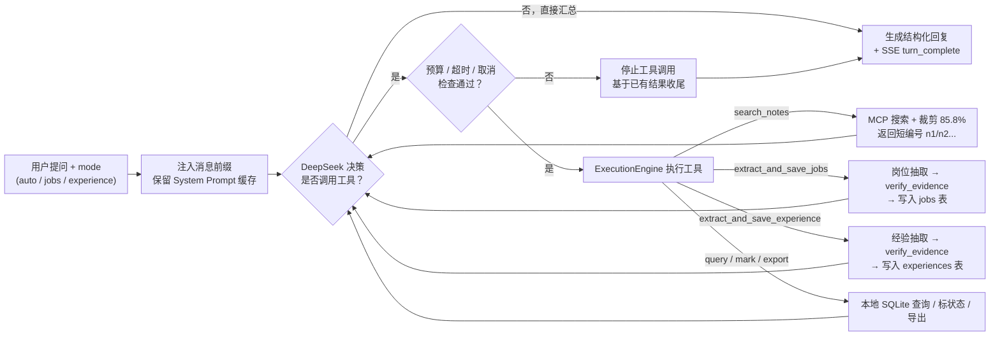

# XHS Intel Agent · 小红书实习与学习情报双模式工作台

基于自研 Agent Harness 与 MCP 协议的本地智能情报工作台。用自然语言描述需求，Agent 自主拆解关键词检索小红书笔记，经独立抽取管道与原文证据防编造校验后，分别沉淀到**实习岗位库**与**学习经验 / 面经知识库**，支持实时进度流、状态跟进及一键导出 Excel / Markdown 笔记。

**本地优先** · 双模式协同（岗位情报 + 学习经验） · 原文防编造校验 · DeepSeek 上下文缓存 · MCP 只读白名单

[功能](#功能) · [技术栈](#技术栈) · [系统架构](#系统架构) · [Harness 结构](#harness-结构设计) · [双模式与 Agent Loop](#双模式与-agent-loop) · [防编造与评估](#防编造与评估) · [项目结构](#项目结构) · [快速开始](#快速开始) · [致谢与声明](#致谢与声明)

> **学习与使用说明**
>
> - 本项目为**个人学习与研究用途**的 AI Agent 工程实践项目（练习自研 Agent Loop、工具编排、结构化抽取防编造、防风控限流与 SSE 全栈工作台），仅限个人低频使用，严禁用于商业用途或高频批量抓取。
> - 本项目的小红书检索能力**借鉴并接入了开源项目 [xpzouying/xiaohongshu-mcp](https://github.com/xpzouying/xiaohongshu-mcp)**，通过官方 MCP（Streamable HTTP）协议以**严格只读白名单**方式调用其 Docker 服务，不包含任何平台逆向、写操作或绕过风控逻辑。

---

## 功能

| 能力 | 在工作台里可以做什么 |
| --- | --- |
| **双模式智能检索** | 顶部支持「智能识别 / 找岗位 / 找经验」三态切换，Agent 自主拆词、搭配小红书原生排序（如「最多收藏」「半年内」）并行/协同完成检索与入库，对话区实时展示当前步骤与耗时，右侧直播完整执行时间线。 |
| **实习岗位情报库** | 自动抽取公司、岗位、城市、届别、学历、技能、薪资、出勤、投递方式与原文证据，双层去重并标记过期（>60 天）与需看图提示；支持多维筛选、跟进状态流转（新发现 / 感兴趣 / 已投递 / 已拒绝 / 已过期）与一键导出 `.xlsx`。 |
| **经验与面经知识库** | 覆盖「学习路线 / 项目实战 / 面试真题 / 技巧避坑（含 AI 编程工具如 Codex / Claude Code / MCP 技巧）」四类知识卡片，提炼核心要点、技术栈、开源资源与避坑提醒；支持学习状态管理与一键导出 `.md` 学习笔记或 `.xlsx`。 |
| **监控与 Trace 回放** | 汇总 CLI 与 Web 所有历史会话轨迹（`traces/*.jsonl`），统计主模型与双抽取器总 Token、DeepSeek 上下文缓存命中率、人民币估算费用以及当日防风控配额余量。 |
| **网页扫码与安全护栏** | 顶部状态栏实时监控 MCP 连通性与登录态，未登录时支持弹窗拉取二维码扫码；单任务互斥锁（`409` 防并发风控）与运行中随时安全取消。 |

---

## 技术栈

**Agent Harness 与模型**


基于 OpenAI 兼容接口接入 DeepSeek（原生 Function Calling + JSON 输出模式 + 前缀缓存），不依赖重型 Agent 框架，手写轻量可控的 Harness（`ToolRegistry` / `ExecutionEngine` / `BudgetTracker` / `ContextManager` / `AgentLoop` / `TraceLogger`）。

**后端 API 与存储**


FastAPI 提供 REST API、SSE 实时事件流与静态 SPA 单端口托管；SQLite（WAL 模式 + 线程锁）持久化笔记缓存、岗位库、经验库与每日防风控配额。

**前端界面**


React 19 + TypeScript + Tailwind CSS v4 构建四视图工作台，Vite 构建产物直接由 FastAPI 同源托管在 `127.0.0.1:8000`。

<details>
<summary>更多工程细节与依赖清单</summary>

| 模块 | 实现细节 |
| --- | --- |
| 小红书适配层 | `MCPClient`（Streamable HTTP 长连接 + 自动重连） · `RateLimiter`（`asyncio.Lock` 串行 + 3–8s 随机抖动 + 每日配额） · `NoteCache`（短编号 `n1/n2` 隐藏凭证 + `feed_id[:8]` 十六进制解码发布时间，搜索载荷压缩 **85.8%**） |
| 抽取与防编造 | 主模型与抽取器解耦；抽取结果强制携带原文连续子串 `evidence`，经代码级归一化匹配 `verify_evidence()` 核验未通过则直接丢弃 |
| 双模式隔离 | 共用 `notes.detail_json` 详情缓存避免重复抓取，通过 `processed_at` / `exp_processed_at` 独立去重，写入完全隔离的 `jobs` 与 `experiences` 表 |
| 导出与外链 | `openpyxl` 导出规范化 Excel；内置 Markdown 模板按分类导出复习笔记；Web 外链自动拼接 `xsec_token` 减少跳链拦截 |
| 自动化测试 | `pytest` + `pytest-asyncio` + FastAPI `TestClient`，**57 项离线测试**（基于真实录制 fixtures，不消耗 LLM 与小红书配额） |

</details>

---

## 系统架构



---

## Harness 结构设计

本项目不依赖 LangChain / AutoGen 等重型编排框架，而是在 [xhs_agent/harness/](xhs_agent/harness/) 中手写了一套轻量、可控、可离线单测的 **Agent Harness**。核心原则是把 **「大模型推理决策」** 与 **「代码级确定性护栏」** 彻底分离：模型只负责规划关键词、选择工具与归纳回答，所有安全边界（白名单、Schema 校验、超时、重试、预算熔断、上下文配对压缩、费用核算与轨迹审计）均由 Harness 强约束执行。



### 8 个核心模块职责

| 模块 | 核心类 / 能力 | 关键工程设计 |
| --- | --- | --- |
| [runtime.py](xhs_agent/harness/runtime.py) | `AgentRuntime`、`AgentSession`、`build_v1_registry` | 启动时执行三项预检（MCP 连通、只读白名单 Schema 校验、小红书登录态检查）；按 `MODE_PREFIX_HINTS` 注入模式提示而不改动 System Prompt，保住多轮缓存；合并统计主模型与岗位/经验双抽取器的 Token 消耗。 |
| [loop.py](xhs_agent/harness/loop.py) | `AgentLoop`、`AgentRunResult` | 驱动 `LLM → Tool → Observation` 主循环；每步前检测 `cancel_event` 实现安全取消；达到 `max_steps` 或预算耗尽时自动降级为不带 `tools` 的收尾请求，强制基于已有结果作答；通过 `on_event` 回调同时驱动 CLI 输出与 Web SSE 实时流。 |
| [registry.py](xhs_agent/harness/registry.py) | `ToolRegistry`、`ToolSpec` | 统一声明工具的 JSON Schema、只读标记、单次超时时间与预算分组（如 `search`、`detail`），并自动导出 OpenAI Function Calling 格式的 `tools` 列表。 |
| [executor.py](xhs_agent/harness/executor.py) | `ExecutionEngine`、`BudgetTracker` | 每次工具调用严格经过 5 道关卡：① 白名单存在性检查 → ② 参数 JSON 解析与 `jsonschema` 强校验 → ③ 预算组次数上限检查 → ④ `asyncio.wait_for` 超时与可重试网络错误退避重试 → ⑤ 所有异常封装为 `{"ok": false, "error": ..., "retryable": ...}` 回传模型，绝不导致主循环崩溃。 |
| [context.py](xhs_agent/harness/context.py) | `ContextManager` | System Prompt 固定置顶且消息仅向后追加以最大化 DeepSeek 前缀缓存命中；当总字符超过 `48,000` 阈值时，按「`assistant(tool_calls)` + 对应全部 `tool` 响应」原子成组做摘要压缩或裁剪，绝不破坏 API 的 `tool_call_id` 配对协议。 |
| [llm.py](xhs_agent/harness/llm.py) | `DeepSeekClient`、`LLMClientProtocol` | 封装 OpenAI 兼容客户端，提取 `prompt_cache_hit_tokens` / `cache_miss_tokens`；基于 Protocol 抽象，离线测试可直接注入 `ScriptedLLM` 实现零费用、100% 可复现的回归验证。 |
| [trace.py](xhs_agent/harness/trace.py) | `TraceLogger` | 将每次运行的 `turn_start`、`llm_request/response`、`tool_call/result`、`budget_exhausted`、`cancelled`、`turn_complete` 实时追加写入 `traces/<session_id>.jsonl`，直接支撑 Web「监控与 Trace 回放」视图。 |
| [pricing.py](xhs_agent/harness/pricing.py) | `CostEstimate`、`estimate_cost` | 读取 `config.toml` 的 `[pricing]` 费率表，拆分计算缓存命中费用、未命中费用、输出费用与缓存节省金额（CNY）。 |

### 上下文压缩机制（两层防膨胀）

为了在多轮检索中同时做到 **低 Token 成本、高前缀缓存命中率、不破坏 `tool_calls` 协议**，上下文治理分为**源头降噪**与**两阶段安全压缩**两层：

1. **源头降噪（进上下文之前就瘦身）**
   - **搜索载荷裁剪 -85.8%**：`search_notes` 过滤掉头像/封面签名 URL、推荐埋点与长 `xsec_token`，只把短编号（`n1/n2...`）与标题/作者/发布时间/赞评数 6 个字段返给主模型；
   - **子抽取器上下文隔离**：`extract_and_save_jobs` 与 `extract_and_save_experience` 在内部起独立的 JSON 抽取 LLM 处理笔记全文，**正文原文绝不塞进主 Agent 上下文**，主模型只收到一行入库摘要（`note=n3 status=saved created=1`）。
2. **两阶段安全压缩（[context.py](xhs_agent/harness/context.py)）**
   - 正常运行时消息**只向后追加**（System Prompt 固定置顶），不做原地改写，最大化 DeepSeek 前缀缓存命中率；
   - 仅当总字符超过阈值 `max_chars = 48,000` 时触发裁剪，始终锁定保留头部（System Prompt + 首轮需求）与最近 `keep_recent_turns = 6` 组原子轮次：
     - **阶段一（工具结果摘要替换）**：把较早轮次的 `role="tool"` 大段 JSON 替换为一行合法紧凑 JSON 摘要（`{"ok": true, "summary": "..."}`），完整保留 `assistant(tool_calls) → tool` 配对关系；
     - **阶段二（原子轮次整组淘汰）**：若仍超 `48,000` 字符，则按「`assistant(tool_calls)` + 对应全部 `tool` 消息」**整组**丢弃最早轮次，杜绝孤立 `tool_call_id` 导致 API 报错。

### 记忆机制（三层分层）

| 记忆层 | 载体 | 生命周期 | 作用 |
| --- | --- | --- | --- |
| **短期工作记忆** | `ContextManager` + `NoteCache`（内存） | 单次会话内（支持 CLI `-i` 与 Web 多轮追问） | 保存多轮对话上下文、以及短编号 `n1/n2...` 到真实 `(feed_id, xsec_token, detail)` 的映射。 |
| **长期结构化记忆** | 本地 SQLite `data/xhs_jobs.db`（WAL 模式） | 跨会话永久持久化 | 4 张核心表：`notes`（原帖全文缓存 + `processed_at`/`exp_processed_at` 双去重标记）、`jobs`（岗位库）、`experiences`（经验库）、`daily_usage`（每日限流计数）。新会话可直接调 `query_jobs` / `query_experiences` 检索历史沉淀，无需重搜小红书。 |
| **审计回放记忆** | `traces/<session_id>.jsonl` | 永久持久化 | 逐事件记录每次 LLM 与工具调用、耗时、Token 与费用，供 Web「监控与 Trace 回放」页复盘。 |

> **当前边界说明**：长期记忆目前采用**确定性结构化存储（SQLite + SQL 筛选）**，暂未引入跨会话聊天记录持久化或向量语义记忆；Web 重启后内存中的旧聊天上下文会清空，但所有已入库的岗位、经验、原帖缓存与 Trace 轨迹均完整留存。

### Tool 清单（全部 10 个注册工具）

全部注册于 [runtime.py](xhs_agent/harness/runtime.py) 的 `ToolRegistry`，供 DeepSeek 通过原生 Function Calling 调度：

| 分组 | 工具名 | 读写 | 超时 / 预算组 | 职责说明 |
| --- | --- | --- | --- | --- |
| **公共检索** | `search_notes` | 只读 | `35s` / `search` | 调 MCP 搜索小红书，按 `sort_by` / `publish_time` / `note_type` 过滤，裁剪返回短编号列表（`n1/n2...`） |
| **公共检索** | `get_note_detail` | 只读 | `95s` / `detail` | 可选正文预览（仅标题极模糊时使用，优先命中本地缓存） |
| **岗位管道** | `extract_and_save_jobs` | 写本地库 | `150s` / `detail` | 独立岗位抽取 LLM + `verify_evidence()` 原文核验 + 双层去重写入 `jobs` 表 |
| **岗位管道** | `query_jobs` | 只读 | `15s` / 不限 | 按城市、关键词、届别、状态、60 天时效查询本地 `jobs` 表 |
| **岗位管道** | `mark_job` | 写本地库 | `15s` / 不限 | 更新岗位跟进状态（`new / interested / applied / rejected / expired`） |
| **岗位管道** | `export_jobs` | 写本地文件 | `30s` / 不限 | 导出规范化岗位情报 Excel（`.xlsx`） |
| **经验管道** | `extract_and_save_experience` | 写本地库 | `150s` / `detail` | 独立经验抽取 LLM + `verify_evidence()` 原文核验 + 去重写入 `experiences` 表 |
| **经验管道** | `query_experiences` | 只读 | `15s` / 不限 | 按分类（`roadmap / project / interview / tips`）、主题、关键词、学习状态查询 `experiences` 表 |
| **经验管道** | `mark_experience` | 写本地库 | `15s` / 不限 | 更新经验学习状态（`unread / reading / starred / archived`） |
| **经验管道** | `export_experiences` | 写本地文件 | `30s` / 不限 | 导出结构化 Markdown 学习笔记（`.md`）或 Excel（`.xlsx`） |

### MCP 连接与防风控链路

```text
XhsAdapter (只读白名单校验)
   │  仅放行: check_login_status / search_feeds / get_feed_detail
   │  硬封禁: publish_content / like_feed / post_comment / favorite_feed / delete_cookies 等 9 个写工具
   ▼
RateLimiter (防风控三道闸)
   │  ① 全局 asyncio.Lock 单路串行  ② 两次调用间隔 3s + random(0, 5s)  ③ SQLite 每日硬配额 (search≤50 / detail≤150)
   ▼
MCPClient (Streamable HTTP 长连接)
   │  官方 mcp Python SDK (兼容 1.x / 2.x) → http://localhost:18060/mcp（断线自动重连一次）
   ▼
Docker: xpzouying/xiaohongshu-mcp
      无头浏览器挂载 ./data/xhs_mcp/cookies.json，返回小红书原始 JSON
```

- **启动三项预检（Fail-Fast）**：Runtime 启动时自动校验 ① MCP 端口可达、② 白名单 3 工具存在且必填参数 Schema 匹配、③ 登录态有效，任一项不满足立即报错提示，不浪费 LLM Token。
- **短编号凭证隔离**：真实 `feed_id` 与 `xsec_token` 仅保存在 `NoteCache` / SQLite，模型只接触 `n1/n2`，彻底避免模型抄错 token 或泄露凭证；同时利用 `int(feed_id[:8], 16)` 解码精确发布时间（20 篇实测 0 秒误差）。

### Hook 与生命周期拦截点

本项目目前**没有**提供外部声明式配置 Hook（如读取 `hooks.json` 执行外部 Shell 命令），但在 Harness 内部以**代码级拦截点与事件回调**实现了等效的生命周期 Hook：

| 机制 | 位置 | 触发时机与作用 |
| --- | --- | --- |
| **Pre-Tool Guard（执行前拦截）** | `ExecutionEngine.execute()` · `XhsAdapter.call_allowed_tool()` | 工具调用前依次拦截：白名单检查 → `jsonschema` 参数校验 → 预算组上限检查 → MCP 只读白名单 → `RateLimiter` 串行与每日配额闸门。 |
| **Post-Extract Guard（入库前防编造）** | `verify_evidence()`（`jobs/extract.py` & `knowledge/extract.py`） | 抽取 LLM 返回后强制校验 `evidence` 是否为原文连续子串，不通过直接拦截丢弃；来源字段（`note_id`、`source_url`、`published_at`）由代码强覆盖，不信任模型输出。 |
| **Event Hook（`on_event` 观察者回调）** | `AgentLoop.run_turn(..., on_event=...)` | 在 `turn_start`、`llm_request`、`llm_response`、`tool_call`、`tool_result`、`budget_exhausted`、`cancelled`、`turn_complete` 8 个节点统一派发事件，CLI 渲染、Trace 落盘与 Web SSE 实时推送均作为订阅者挂载其上。 |
| **Cancel Hook（协作式取消）** | `cancel_event: asyncio.Event` | 每轮循环与工具调用前检测取消信号，支持 Web 端随时中止长耗时任务并安全释放单任务互斥锁。 |

---

## 双模式与 Agent Loop

系统采用 **「单套统一 Harness + 10 个分组工具 + 消息级 Mode Prefix + 双管道隔离存储」** 设计，而不是维护多套 Prompt：

- **保住上下文缓存**：`auto` / `jobs` / `experience` 模式不改动 System Prompt，仅在用户消息前注入简短模式提示（`MODE_PREFIX_HINTS`），同一会话内自由切换模式仍能命中 DeepSeek 前缀缓存（命中成本降低 90%）。
- **工具分组与严格隔离**：公共检索工具（`search_notes`、`get_note_detail`）共享限流与详情缓存；岗位工具组与经验工具组各自读写独立表与独立去重时间戳，互不污染。



<details>
<summary>核心模块与源码入口对照</summary>

| 环节 | 源码路径 |
| --- | --- |
| Harness 运行时与 10 工具注册 | [xhs_agent/harness/runtime.py](xhs_agent/harness/runtime.py) |
| Agent Loop 与预算/取消边界 | [xhs_agent/harness/loop.py](xhs_agent/harness/loop.py) · [xhs_agent/harness/executor.py](xhs_agent/harness/executor.py) |
| 小红书适配层、限流与短编号缓存 | [xhs_agent/xhs/adapter.py](xhs_agent/xhs/adapter.py) · [xhs_agent/xhs/rate_limiter.py](xhs_agent/xhs/rate_limiter.py) · [xhs_agent/xhs/cache.py](xhs_agent/xhs/cache.py) |
| 岗位抽取与双层去重 | [xhs_agent/jobs/extract.py](xhs_agent/jobs/extract.py) · [xhs_agent/jobs/dedup.py](xhs_agent/jobs/dedup.py) · [xhs_agent/jobs/tools.py](xhs_agent/jobs/tools.py) |
| 经验知识抽取与 Markdown/Excel 导出 | [xhs_agent/knowledge/extract.py](xhs_agent/knowledge/extract.py) · [xhs_agent/knowledge/tools.py](xhs_agent/knowledge/tools.py) |
| SQLite 持久化（WAL + 线程锁） | [xhs_agent/jobs/store.py](xhs_agent/jobs/store.py) |
| FastAPI + SSE 任务管理器 | [xhs_agent/api/app.py](xhs_agent/api/app.py) · [xhs_agent/api/task_manager.py](xhs_agent/api/task_manager.py) |
| React 四视图工作台 | [web/src/pages/WorkspacePage.tsx](web/src/pages/WorkspacePage.tsx) · [web/src/pages/JobsPage.tsx](web/src/pages/JobsPage.tsx) · [web/src/pages/ExperiencesPage.tsx](web/src/pages/ExperiencesPage.tsx) · [web/src/pages/TracesPage.tsx](web/src/pages/TracesPage.tsx) |

</details>

---

## 防编造与评估

本项目在 20 篇真实录制的小红书笔记（[evals/samples/](evals/samples/) 与人工复核表 [evals/manual_review.md](evals/manual_review.md)）上运行离线评测（`uv run python evals/run_eval.py`），实测指标如下：

| 评测维度 | 实测结果 | 说明 |
| --- | --- | --- |
| 招聘帖识别准确率 | **100.0%** | 精准区分一线直招帖与面经 / Vlog / 广告帖 |
| 岗位漏抽率 | **0.0%** | 有效招聘帖无遗漏 |
| 字段编造率 | **0.0%** | 原文证据 `verify_evidence()` 拦截 + 来源元数据由代码强填充 |
| 核心字段准确率 | **97.8%** | 公司、岗位、城市、届别、投递方式等综合核对 |
| 看图提醒（`needs_image`）准确率 | **100.0%** | 准确识别关键信息位于图片中的帖子 |
| 离线自动化测试 | **57 / 57 通过** | 覆盖适配层、Harness、岗位与经验管道、API 与 SSE 流 |

---

## 项目结构

```text
xhs-intel-agent/
├── config.toml                 # 模型、MCP 地址、防风控限流、预算与费率配置
├── docker-compose.yml          # xpzouying/xiaohongshu-mcp Docker 服务编排
├── pyproject.toml              # Python 依赖与 pytest 配置（uv 管理）
├── xhs_agent/
│   ├── xhs/                    # MCPClient、RateLimiter、NoteCache、XhsAdapter
│   ├── harness/                # ToolRegistry、ExecutionEngine、AgentLoop、Context、Trace、Pricing
│   ├── jobs/                   # 岗位模型、抽取器、双层去重、SQLite Store、Excel 导出
│   ├── knowledge/              # 经验模型、抽取器、Markdown/Excel 导出与工具集
│   ├── api/                    # FastAPI 应用、单任务 TaskManager、SSE 与 REST 路由
│   └── prompts/                # 主 Agent 与双抽取器提示词
├── web/                        # React 19 + TypeScript + Vite + Tailwind v4 前端
├── evals/                      # 20 篇真实样本标注集、人工评估表与自动评测脚本
├── scripts/                    # 登录态/MCP/LLM 探测与冒烟脚本
├── tests/                      # 57 项离线单元、集成与 SSE 测试（含真实 fixtures）
└── docs/                       # 架构设计、分阶段开发方案与阶段总结
```

---

## 快速开始

需要 **Python 3.11+**（推荐使用 `uv`）、**Node.js 22+** 与 **Docker Desktop**。

### 1. 克隆项目与准备环境

```powershell
git clone https://github.com/ifhgh666/xhs-intel-agent.git
cd xhs-intel-agent

# 安装 Python 依赖
uv sync

# 复制环境变量模板并填入你的 DEEPSEEK_API_KEY
copy .env.example .env
```

### 2. 启动 xiaohongshu-mcp（Docker）

本项目通过 Docker 运行开源的 [xpzouying/xiaohongshu-mcp](https://github.com/xpzouying/xiaohongshu-mcp)，将登录态持久化在本地 `data/xhs_mcp/cookies.json`（已被 `.gitignore` 忽略，绝不上传）：

```powershell
docker compose up -d

# 检查登录状态（也可启动 Web 后在界面右上角直接扫码）
uv run python scripts/probe_login.py
```

### 3. 启动 Web 全栈工作台（推荐）

```powershell
# 构建前端静态产物（首次或修改前端后执行）
cd web && npm install && npm run build && cd ..

# 启动 FastAPI 单端口服务（仅监听本机 127.0.0.1:8000）
uv run python -m xhs_agent.api
```

打开浏览器访问 **http://127.0.0.1:8000/** 即可使用完整工作台。如未登录小红书，点击顶部提示条的「立即扫码」即可完成登录。

### 4. CLI 模式与测试验证

```powershell
# 单轮命令行检索并导出
uv run python -m xhs_agent "帮我搜索广州的 AI Agent、RAG 实习岗位，入库后导出 Excel。"

# 多轮交互式 CLI（支持追问筛选、mark_job / mark_experience 标状态）
uv run python -m xhs_agent -i

# 运行全部 57 项离线单元测试（不依赖小红书与真实 LLM）
uv run pytest -v

# 运行 20 篇真实样本抽取评估（需配置 DEEPSEEK_API_KEY）
uv run python evals/run_eval.py
```

---

## 项目文档

- [系统设计文档](docs/design.md)：整体架构、模块职责、工具协议与数据模型
- [分阶段开发方案](docs/development_plan.md)：Phase 0–5 任务拆解与验收标准
- [Web 前后端设计方案](docs/web_fullstack_plan.md)：FastAPI + SSE 后端与 React 工作台架构设计
- [双模式扩展方案](docs/dual_mode_plan.md)：岗位情报 + 学习经验/面经双管道解耦方案
- [20 篇样本人工评估表](evals/manual_review.md)：真实笔记字段结构分析与图片识别优先级结论
- [分阶段开发复盘](docs/phases/)：Phase 0–5 实践记录与踩坑总结

---

## 致谢与声明

### 开源致谢

- 衷心感谢开源项目 **[xpzouying/xiaohongshu-mcp](https://github.com/xpzouying/xiaohongshu-mcp)**。本项目的小红书 MCP 接入方案深度借鉴并直接对接了该项目的 Docker MCP 服务，在此致以诚挚感谢。
- 感谢 [Model Context Protocol (MCP)](https://modelcontextprotocol.io/)、DeepSeek、FastAPI、React 与 Vite 开源社区。

### 个人学习与合规免责声明

1. **仅限个人学习与研究**：本项目定位为 AI Agent Harness、MCP 协议集成、结构化信息防编造与全栈交互设计的**个人学习项目**，禁止用于任何商业用途、数据转售或自动化营销。
2. **严格只读与低频访问**：代码层面已强制封禁所有点赞、评论、发帖、关注、删 Cookie 等写操作，并内置单路串行锁、3–8 秒随机间隔与每日配额上限；请勿私自调大并发或取消限流。
3. **遵守平台规则与隐私安全**：使用本项目产生的本地数据库（`data/`）、登录凭证（`cookies.json`）、API 密钥（`.env`）与运行轨迹（`traces/`）仅存于本机并已在 `.gitignore` 中严格排除，请妥善保管个人凭证；若触发平台验证或账号风控提示，请立即停止使用。
