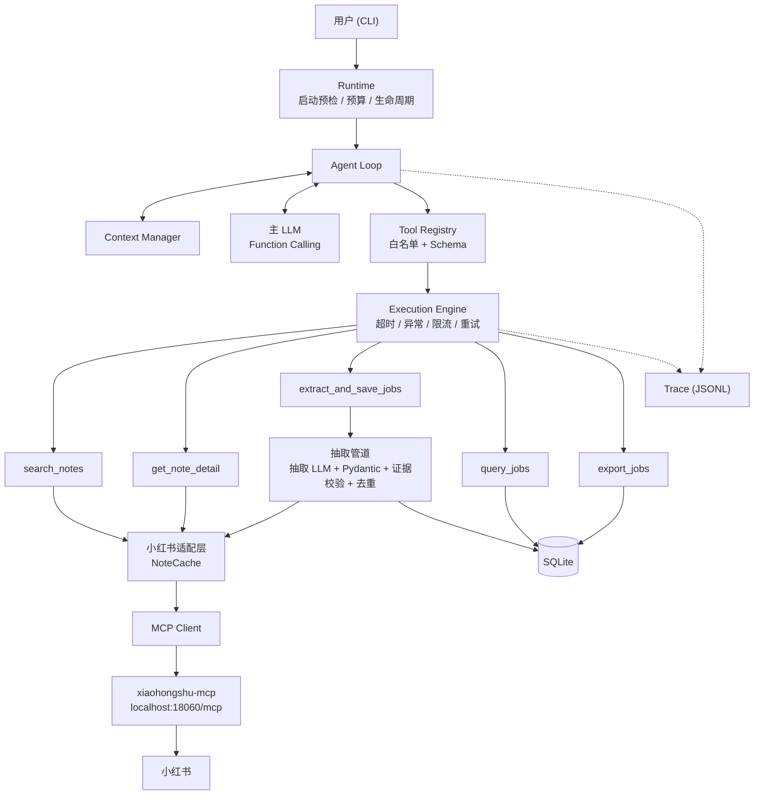
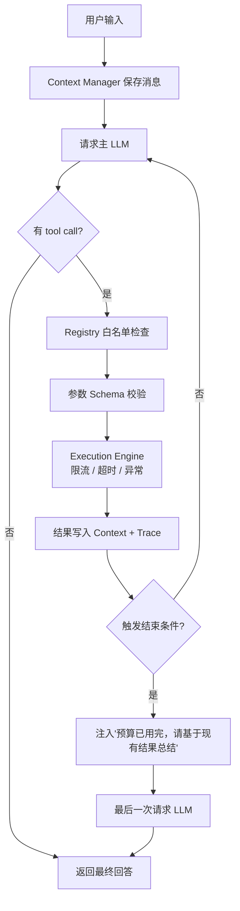
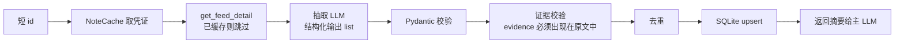
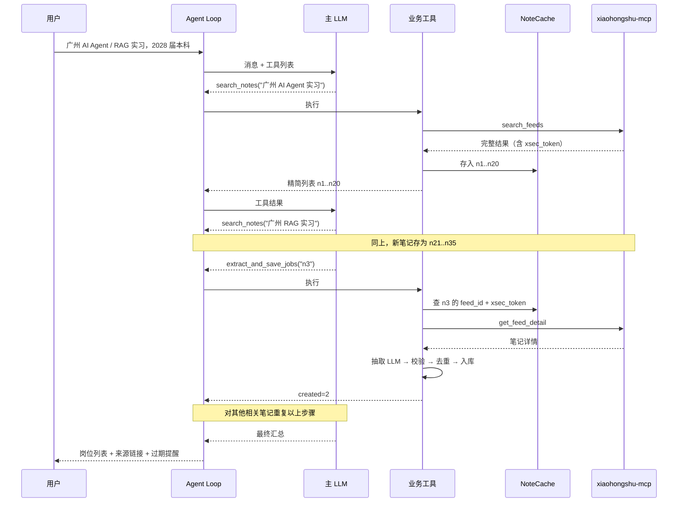

# 小红书实习情报 Agent — Harness 设计文档（修订版 v2）

## 1. 项目目标

开发一个基于 Python 的小红书实习信息搜索 Agent。

用户用自然语言提出需求，Agent 自主决定搜索关键词和要查看的笔记，从笔记中提取招聘信息，存入本地数据库，最后汇总结果。

**示例输入：**

> 帮我搜索广州的 AI Agent、RAG 实习岗位，优先找适合 2028 届本科生的岗位。

**Agent 自动完成：**

1. 理解需求（城市、方向、届别、学历）
2. 拆分出多个搜索关键词
3. 搜索小红书笔记
4. 根据标题、发布时间筛选相关笔记
5. 对选中的笔记：获取详情 → 结构化抽取 → 校验 → 去重 → 入库
6. 汇总本次收集的岗位，必要时导出 Excel

**第一版目标：** 实现一个 Python Agent Harness，能够动态发现 MCP 工具，通过 Function Calling 自主选择工具，在安全、限流、可追踪的前提下执行工具，并根据结果继续推理。

### 技术选型

| 项 | 选择 |
|---|---|
| 项目目录 | `C:\Users\ifhgz\Desktop\xhs` |
| 语言 / 包管理 | Python 3.11+ / `uv` |
| LLM | DeepSeek，通过 `openai` SDK 调用（`base_url = https://api.deepseek.com`） |
| 主 Agent | `deepseek-chat` + Function Calling |
| 岗位抽取 | `deepseek-chat` + JSON 输出模式，temperature = 0 |
| 小红书 | xiaohongshu-mcp（Windows 预编译版本） |
| 存储 / 导出 | SQLite / Excel |

> [!TIP]
> DeepSeek 会自动缓存相同的请求前缀，命中部分价格低很多。保持 system prompt 和工具列表固定并放在最前面，消息只往后追加，能明显降低费用。

---

## 2. 核心设计原则

1. **LLM 负责决策，Harness 负责执行。** LLM 决定搜什么、看哪篇、何时停止；Harness 负责凭证、缓存、限流、校验、存储。
2. **开放的决策交给 Agent，固定的流程交给代码。** "获取详情 → 抽取 → 校验 → 去重 → 入库"每次都一样，写成确定性管道，不让主 LLM 逐步操作。
3. **执行细节不暴露给 LLM。** `xsec_token`、原始 JSON、图片 URL 等由 Harness 保管，LLM 只看到精简后的结果。
4. **只读优先，写操作默认禁止。** MCP 提供的发帖、评论、点赞等工具一律不注册给 LLM。
5. **不允许编造。** 抽取结果必须附带原文证据，代码校验不通过就丢弃。
6. **一切可追踪。** 每次 LLM 调用、工具调用都写入 trace，作为调试、评估和以后 Journal / Resume 的基础。
7. MCP Server 只提供外部能力，MCP Client 只负责连接和调用，二者都不参与任务规划。

---

## 3. 整体架构



### 分层说明

| 层 | 组成 | LLM 能看到吗 |
|---|---|---|
| 决策层 | 主 LLM | — |
| Harness 层 | Agent Loop、Context Manager、Tool Registry、Execution Engine、Runtime、Trace | 只能看到 Registry 暴露的工具 |
| 业务工具层 | `search_notes`、`get_note_detail`、`extract_and_save_jobs`、`query_jobs`、`export_jobs` | ✅ 这些是注册给 LLM 的工具 |
| 适配层 | NoteCache、结果裁剪、凭证注入 | ❌ |
| 外部层 | MCP Client → xiaohongshu-mcp → 小红书 | ❌ |

---

## 4. 模块职责

| 模块 | 职责 |
|---|---|
| **Runtime** | 启动时连接 MCP、检查登录状态、初始化数据库；管理任务预算（步数、token、工具次数）；退出时清理资源 |
| **Agent Loop** | 循环调用 LLM → 解析 tool call → 执行 → 回填结果；判断结束条件 |
| **Context Manager** | 管理消息历史、工具结果回填、上下文长度控制、会话隔离 |
| **Tool Registry** | 统一注册所有工具，管理白名单和权限标记，转换为 Function Calling 格式 |
| **Execution Engine** | 参数校验、超时、异常捕获、限流、单工具调用上限、MCP 断线重连 |
| **MCP Client** | 连接 MCP Server、`list_tools()`、`call_tool()` |
| **小红书适配层** | 包装原始 MCP 工具；用 NoteCache 保存 `xsec_token` 和原始数据；裁剪返回结果 |
| **抽取管道** | 详情 → 抽取 LLM → Pydantic 校验 → 证据校验 → 去重 → upsert |
| **Trace** | 以 JSONL 记录每一步，方便调试和评估 |

---

## 5. 外部工具：小红书 MCP

使用开源项目：https://github.com/xpzouying/xiaohongshu-mcp

- 传输方式：Streamable HTTP，默认地址 `http://localhost:18060/mcp`
- Python 端使用官方 `mcp` SDK 的 `streamablehttp_client` + `ClientSession`
- 底层通过浏览器模拟操作，**只有一个浏览器实例，所有调用必须串行**

### 5.1 工具发现与白名单

启动时调用一次 `list_tools()`，用来**确认工具存在、读取参数 Schema**。实际工具名称和参数以返回结果为准。

`list_tools()` 返回的工具不全部注册给 LLM，按白名单处理：

| MCP 原始工具 | 处理方式 |
|---|---|
| `check_login_status` | 由 Runtime 启动时调用（预检），不交给 LLM |
| `search_feeds` | 由适配层包装为 `search_notes` |
| `get_feed_detail` | 由适配层包装，供 `get_note_detail` 和抽取管道内部使用 |
| `get_login_qrcode` | 仅在 CLI 登录流程中使用 |
| 评论、用户主页等只读工具 | 第一版不使用，以后按需包装 |
| `publish_content`、`post_comment_to_feed`、`like_feed`、`favorite_feed` 等写操作 | **禁止**，永不注册 |

如果启动时发现白名单里的工具缺失，或者参数 Schema 和预期不一致，Runtime 直接报错，避免运行到一半才失败。

### 5.2 连接生命周期

```text
启动 Runtime
  → 连接 MCP Server
  → list_tools()，校验白名单工具及 Schema
  → check_login_status()，未登录则提示扫码并退出
  → 注册业务工具到 Tool Registry
  → 进入 Agent Loop（期间复用同一个 MCP 会话）
  → 进程退出时关闭会话
```

- 运行期间断线：Execution Engine 自动重连一次，失败则把错误返回给 LLM。
- MCP Server 新增工具不会被自动发现，重启或手动刷新注册表即可。

---

## 6. 小红书适配层与 NoteCache

### 6.1 为什么需要

`get_feed_detail` 需要 `feed_id` + `xsec_token` 两个参数。`xsec_token` 是从搜索结果中获取的长随机字符串：

- 让 LLM 原样抄写，容易抄错导致调用失败；
- 原始搜索结果包含大量 LLM 用不到的字段，浪费上下文；
- `xsec_token` 只是访问凭证，与决策无关。

### 6.2 做法

- **NoteCache 不是工具**，只是 Harness 内部的字典（以后可以持久化到 SQLite），LLM 看不到它。
- 注册给 LLM 的是包装后的函数。包装函数内部调用 MCP，同时读写 NoteCache。
- LLM 只拿到 `n1`、`n2` 这样的短编号，凭证由代码自动注入。

```text
LLM: search_notes("广州 AI实习")
  └─ 包装函数：调用 MCP search_feeds
              → 完整结果存入 NoteCache：n1 → (feed_id, xsec_token, 标题, 作者, 时间, 原始JSON)
              → 只返回给 LLM：[{note: "n1", title, author, published_at}, ...]

LLM: extract_and_save_jobs(note="n1")
  └─ 查 NoteCache 拿到 feed_id + xsec_token → 调用 MCP get_feed_detail → 后续管道
```

### 6.3 示例代码

```python
class NoteCache:
    """搜索结果和笔记详情的缓存，只供 Harness 内部使用"""

    def __init__(self):
        self._by_short: dict[str, dict] = {}
        self._by_feed: dict[str, str] = {}      # feed_id -> 短 id，用于去重

    def put(self, raw: dict) -> str:
        feed_id = raw["id"]                     # 字段名以 MCP 实际返回为准
        if feed_id in self._by_feed:
            return self._by_feed[feed_id]
        sid = f"n{len(self._by_short) + 1}"
        self._by_short[sid] = {
            "feed_id": feed_id,
            "xsec_token": raw["xsecToken"],
            "title": raw.get("title"),
            "raw": raw,
            "detail": None,                     # 拉取详情后回填，避免重复请求
        }
        self._by_feed[feed_id] = sid
        return sid

    def get(self, sid: str) -> dict | None:
        return self._by_short.get(sid)
```

---

## 7. LLM 可见的工具清单（第一版）

| 工具 | 类型 | 参数 | 返回给 LLM | 副作用 |
|---|---|---|---|---|
| `search_notes` | 包装 MCP | `keyword`，可选 `sort` / `publish_time` 等筛选 | 精简列表：短 id、标题、作者、发布时间 | 无（只读） |
| `get_note_detail` | 包装 MCP | `note`（短 id） | 标题、正文前 N 字、发布时间、是否包含图片 | 无（只读） |
| `extract_and_save_jobs` | 业务管道 | `note`（短 id） | 一行摘要：新增 / 重复 / 无岗位 / 需看图 | 写本地数据库 |
| `query_jobs` | Python | `city`、`keyword`、`graduation_year`、`since`、`status`、`limit` | 岗位精简列表 | 无 |
| `export_jobs` | Python | 同上筛选条件 + 可选 `path` | 导出文件路径 | 写本地文件 |

说明：

- `get_note_detail` 是可选工具，供 LLM 在标题看不出相关性时先预览。主路径是直接调用 `extract_and_save_jobs`。
- 详情拉取后存入 NoteCache，预览之后再抽取不会重复请求小红书。
- 每个工具在 Registry 中带 `read_only`、`timeout`、`max_calls` 等元数据。

### Registry 中的工具定义示例

```python
@dataclass
class ToolSpec:
    name: str
    description: str
    parameters: dict            # JSON Schema
    handler: Callable[..., Awaitable[Any]]
    read_only: bool = True
    timeout: float = 30
    max_calls_per_task: int | None = None

    def to_openai(self) -> dict:
        return {"type": "function",
                "function": {"name": self.name,
                             "description": self.description,
                             "parameters": self.parameters}}
```

> [!NOTE]
> 如果以后直接注册多个 MCP Server 的原始工具，建议加命名空间前缀，如 `xhs__search_feeds`。OpenAI 函数名只允许 `[a-zA-Z0-9_-]`，不能用点号。MCP 的 `inputSchema` 部分写法在某些厂商的 strict 模式下不支持，转换时需要清洗。

---

## 8. Agent Loop

### 8.1 流程



### 8.2 结束条件

| 条件 | 默认值（可配置） |
|---|---|
| 最大循环步数 | 25 |
| `search_notes` 调用上限 | 6 次 / 任务 |
| `get_note_detail` + `extract_and_save_jobs` 详情拉取上限 | 30 次 / 任务 |
| token / 费用预算 | 按模型设定 |
| 连续工具报错 | 3 次 |
| 业务目标达成 | 可选，如收集到 N 个有效岗位 |

到达上限时**不直接中断**，而是注入一条系统提示，让 LLM 基于已有结果给出总结。

### 8.3 骨架代码

```python
async def run(task: str, rt: Runtime) -> str:
    ctx = rt.new_context(task)
    for step in range(rt.max_steps):
        resp = await rt.llm.chat(ctx.messages(), tools=rt.registry.schemas())
        ctx.add_assistant(resp)
        rt.trace.log("llm", step=step, resp=resp)

        if not resp.tool_calls:
            return resp.content

        for call in resp.tool_calls:
            result = await rt.executor.execute(call)   # 内部处理白名单/校验/超时/限流/异常
            ctx.add_tool_result(call.id, result)
            rt.trace.log("tool", step=step, call=call, result=result)

        if rt.budget.exhausted():
            break

    ctx.add_system("预算已用完，请基于已收集的结果直接给出总结，不要再调用工具。")
    resp = await rt.llm.chat(ctx.messages())
    return resp.content
```

### 8.4 System Prompt 要点

- 写入**当前日期**，便于判断时效
- 说明工作方式：先拆关键词 → 搜索 → 按标题和发布时间筛选 → 对相关笔记调用 `extract_and_save_jobs` → 汇总
- 优先选择最近 1–2 个月发布的笔记
- 已经处理过的笔记不要重复处理
- 不能编造岗位信息，汇总时只引用工具返回的数据

---

## 9. 抽取管道（`extract_and_save_jobs`）

由代码固定执行，主 LLM 只看到最终摘要。



要点：

1. **抽取 LLM 单独调用**，不占用主上下文。使用 DeepSeek JSON 输出模式，temperature = 0。
2. **一篇笔记可能包含多个岗位**，输出 `list[Internship]`；不是招聘笔记则返回空列表。
3. **证据校验**：每条岗位必须带 `evidence`（原文片段），代码检查它确实出现在笔记正文中，不通过就丢弃。
4. **未知字段为 `None`**，prompt 中明确要求"原文没有就留空"。
5. **正文信息不足**（例如只写了"详见图片"）时标记 `needs_image=true`，在摘要中告诉主 LLM。
6. 返回示例：

```json
{"note": "n3", "status": "ok", "created": 2, "duplicates": 1,
 "positions": ["某科技-AI Agent 开发实习", "某科技-RAG 算法实习"],
 "needs_image": false}
```

---

## 10. 数据设计

### 10.1 数据模型

```python
from datetime import datetime
from typing import Literal
from pydantic import BaseModel, Field

class Internship(BaseModel):
    # 岗位信息（原文没有就为 None）
    company: str | None = None
    position: str | None = None
    city: str | None = None
    education: str | None = None
    graduation_year: str | None = None        # 保留原文，如 "2027/2028届"
    skills: list[str] = Field(default_factory=list)
    internship_duration: str | None = None
    attendance_days: str | None = None
    salary: str | None = None
    deadline: str | None = None
    apply_method: str | None = None            # 邮箱 / 链接 / 内推码
    application_url: str | None = None

    # 防编造
    evidence: str                              # 支撑本条信息的原文片段
    confidence: float = Field(ge=0, le=1)

class JobRecord(Internship):
    # 来源（由代码填写，不由 LLM 生成）
    id: int | None = None
    note_id: str
    source_url: str
    note_title: str | None = None
    note_author: str | None = None
    note_published_at: datetime | None = None
    crawled_at: datetime
    needs_image: bool = False

    # 业务状态
    status: Literal["new", "interested", "applied", "rejected", "expired"] = "new"
```

> [!IMPORTANT]
> 来源字段（`note_id`、`source_url`、发布时间等）由代码从 NoteCache 填写，**不让 LLM 生成**，保证可溯源。

### 10.2 数据库表（SQLite）

| 表 | 主要字段 | 用途 |
|---|---|---|
| `notes` | `feed_id` (PK)、`xsec_token`、标题、作者、发布时间、原始 JSON、详情 JSON、`processed_at` | NoteCache 持久化；避免重复抓取 |
| `jobs` | `JobRecord` 全部字段，`dedup_key` 建索引 | 岗位库 |

### 10.3 去重规则

1. **笔记级**：同一个 `feed_id` 只处理一次。
2. **岗位级**：`dedup_key = normalize(company) + normalize(position) + normalize(city)`，同一 JD 被多个账号转发时合并，保留最早的来源，并记录其他来源链接。
3. 公司名或岗位名为空时不做岗位级去重，避免误合并。

### 10.4 时效性

- 保存 `note_published_at`（笔记发布时间），这和岗位是否还在招不是一回事
- 汇总时把超过 N 天（默认 60 天）的笔记标记为"可能已过期"
- 有 `deadline` 且已过期的，自动设为 `expired`

---

## 11. Context Manager

第一版实现：

1. **消息历史**：system / user / assistant / tool 消息按顺序保存
2. **工具结果回填**：每个 `tool_call_id` 对应一条 tool 消息
3. **结果精简**：在适配层按字段裁剪，**不按字符数截断**（截断会破坏 JSON）
4. **历史裁剪**：超过阈值时保留 system 消息、原始用户请求和最近 K 轮，较早的工具结果替换为一行摘要。裁剪时 assistant 的 tool_calls 和对应的 tool 消息要**成对保留或成对删除**，否则 API 会报错
5. **会话隔离**：每个任务一个 `session_id`，各自维护上下文

后续：语义压缩（Context Compact）。

---

## 12. Execution Engine

| 问题 | 处理方式 |
|---|---|
| 工具不存在 / 不在白名单 | 拒绝执行，返回错误给 LLM |
| 参数错误 | 按 JSON Schema 校验，返回具体错误信息让 LLM 修正 |
| 短 id 不存在 | 返回"未知笔记，请先调用 search_notes" |
| 超时 | `asyncio.wait_for`。搜索约 30s，详情约 90s，抽取 LLM 约 60s |
| 执行异常 | 捕获后返回结构化错误 `{"error": ..., "retryable": bool}`，不让整个任务崩溃 |
| MCP 断线 | 自动重连一次，失败则返回错误 |
| 调用次数超限 | 返回"已达上限"，引导 LLM 总结 |
| 限流 | 所有 MCP 调用经过同一个限流器：串行 + 最小间隔 + 随机抖动 |
| 可重试错误 | 网络类错误自动重试 1–2 次（指数退避），业务错误交给 LLM 判断 |

工具执行失败不等于任务失败。错误信息返回给 LLM，由它决定重试、换参数还是跳过。

---

## 13. 防风控（属于第一版必做）

xiaohongshu-mcp 使用你的真实账号，所有请求都直接面对小红书的风控系统。

| 措施 | 默认值 |
|---|---|
| MCP 调用串行，不并发 | `asyncio.Lock` |
| 两次调用之间的最小间隔 + 随机抖动 | 3–8 秒 |
| 单任务详情拉取上限 | 30 |
| 每日搜索 / 详情上限 | 可配置，记录在数据库 |
| 已抓取的笔记走本地缓存 | `notes` 表 |
| 写操作工具 | 永不注册 |

> [!WARNING]
> 仅限个人学习使用，保持低频访问，遵守平台规则。账号出现验证或异常提示时应立即停止。

---

## 14. 图片中的招聘信息

很多招聘笔记的正文只有一句"见图"，JD 写在图片里。

| 阶段 | 做法 |
|---|---|
| 第一阶段 | 人工查看 20 篇目标笔记，统计信息在图片里的比例 |
| 第一版 | 正文不足时标记 `needs_image=true`，汇总时告诉用户 |
| 第二版 | DeepSeek 不支持图片输入。先用本地 OCR（RapidOCR / PaddleOCR）把图片转成文字，再交给 DeepSeek 抽取；效果不好再考虑 Qwen-VL 等多模态模型 |

---

## 15. Runtime 与可观测性

- **启动预检**：MCP 连通性 → 白名单工具和 Schema → 登录状态 → 数据库初始化
- **预算**：步数、token、各工具调用次数，任务结束时输出统计
- **Trace**：每个任务一个 JSONL 文件，每行一个事件：

```json
{"ts": "...", "session": "s_01", "step": 3, "type": "tool_call", "tool": "extract_and_save_jobs", "args": {"note": "n3"}, "duration_ms": 8120, "result_summary": "created=2"}
```

Trace 是以后实现 Journal、Checkpoint、Resume 和 Eval 的基础，第一版就要有。

---

## 16. 一次完整运行示例



---

## 17. 目录结构

```text
xhs/                       # C:\Users\ifhgz\Desktop\xhs
├── docs/                  # design.md、development_plan.md
├── pyproject.toml
├── config.toml            # 模型、限流、预算等配置
├── .env                   # DEEPSEEK_API_KEY（不提交）
├── scripts/               # 阶段 1 的探测脚本
├── traces/                # 运行轨迹（不提交）
├── data/                  # SQLite 数据库、导出的 Excel（不提交）
├── tests/
│   └── fixtures/          # 录制的真实 MCP 返回样本
├── evals/
│   ├── samples/           # 人工标注的笔记与期望抽取结果
│   └── run_eval.py
└── xhs_agent/
    ├── harness/
    │   ├── loop.py        # Agent Loop + 结束条件
    │   ├── context.py     # 消息管理、裁剪、会话隔离
    │   ├── registry.py    # ToolSpec、白名单、Schema 转换
    │   ├── executor.py    # 校验、超时、异常、重试
    │   ├── llm.py         # DeepSeek 客户端封装
    │   ├── runtime.py     # 启动预检、预算、生命周期
    │   └── trace.py       # JSONL trace
    ├── xhs/
    │   ├── mcp_client.py  # 连接、重连、list_tools、call_tool
    │   ├── rate_limiter.py
    │   ├── cache.py       # NoteCache
    │   └── adapter.py     # search_notes / get_note_detail 包装与结果裁剪
    ├── jobs/
    │   ├── models.py      # Pydantic 模型
    │   ├── extract.py     # 抽取 LLM + 证据校验
    │   ├── dedup.py       # 去重规则
    │   ├── store.py       # SQLite 读写
    │   └── tools.py       # extract_and_save_jobs / query_jobs / export_jobs
    ├── prompts/
    │   ├── agent_system.md
    │   └── extract.md
    └── main.py            # CLI 入口
```

---

## 18. 开发计划

### 第一阶段：MCP 接入与数据验证

- [ ] 克隆并启动 xiaohongshu-mcp，完成扫码登录
- [ ] Python MCP Client 连接，调用 `list_tools()`，记录实际工具名和参数 Schema
- [ ] 测试 `search_feeds`，保存一份真实返回样本
- [ ] 测试 `get_feed_detail`（`feed_id` + `xsec_token`），保存一份真实返回样本
- [ ] **写一个不用 LLM 的脚本**：固定关键词 → 搜索 → 详情 → 打印
- [ ] **人工查看 20 篇目标笔记**：评估图片占比、文本质量、字段分布
- [ ] 把这 20 篇整理成评估集初稿（标注期望的抽取结果）

### 第二阶段：基础 Harness

- [ ] ToolSpec + Tool Registry（白名单、权限标记、Schema 转换）
- [ ] NoteCache + 小红书适配层（`search_notes`、`get_note_detail`）
- [ ] Execution Engine（校验、超时、异常、限流、MCP 重连）
- [ ] Context Manager（消息管理、成对裁剪）
- [ ] Agent Loop + 结束条件 + 预算
- [ ] Runtime 启动预检
- [ ] JSONL Trace
- [ ] CLI 入口，跑通"搜索 → 挑选 → 预览 → 总结"

### 第三阶段：业务功能

- [ ] Pydantic 模型 + SQLite（`notes`、`jobs` 表）
- [ ] 抽取 LLM + 证据校验
- [ ] 去重规则
- [ ] `extract_and_save_jobs`
- [ ] `query_jobs`、`export_jobs`（Excel）
- [ ] 用评估集测量抽取准确率，迭代 prompt
- [ ] 时效标记

### 第四阶段：工程化

- [ ] 单元测试（Registry、Executor、去重、证据校验），用录制的 MCP 样本 mock
- [ ] Token 与费用统计
- [ ] 每日调用上限持久化
- [ ] 图片识别（多模态 / OCR）
- [ ] FastAPI 接口（可选）
- [ ] 岗位状态管理（感兴趣 / 已投递 / 已拒绝）

---

## 19. 后续扩展

| 能力 | 作用 | 基础 |
|---|---|---|
| Journal | 记录执行事件 | 第一版的 JSONL Trace |
| Checkpoint / Resume | 中断后恢复任务 | Trace + `notes` 表 + 会话状态 |
| Hooks | 在模型调用、工具执行前后插入逻辑 | Execution Engine 预留前后钩子 |
| Skills | 可复用的任务指令，如"按届别筛选"、"周报汇总" | prompts 目录 |
| Subagent | 把"处理一篇笔记"委派给子 Agent | 抽取管道已经是隔离的 |
| Eval | 评估抽取准确率和端到端效果 | evals 目录 |
| Context Compact | 语义压缩 | Context Manager |
| 细粒度 Permission | 需要人工确认的工具 | ToolSpec 的 `read_only` 标记 |
| 定时任务 | 每天自动搜索新岗位 | `notes` 表增量去重 |

---

## 20. 已知风险与限制

| 风险 | 应对 |
|---|---|
| 账号被风控或封禁 | 限流、串行、缓存、每日上限，低频使用 |
| 招聘信息在图片里，正文抽不到 | 标记 `needs_image`，第二版接入多模态 |
| LLM 编造信息 | 证据校验 + 来源字段由代码填写 |
| 小红书页面改版导致 MCP 失效 | 依赖上游项目更新；启动预检及早发现 |
| 笔记发布时间 ≠ 岗位仍在招 | 时效标记，汇总时提醒用户核实 |
| MCP 返回结构变化 | 适配层集中解析，录制样本做回归测试 |
