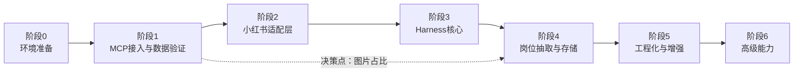

# 小红书实习情报 Agent — 分阶段开发方案

> 配套设计文档：[design.md](./design.md)

## 已确定的技术选型

| 项 | 选择 |
|---|---|
| 项目目录 | `C:\Users\ifhgz\Desktop\xhs` |
| 语言 | Python 3.11+ |
| 包管理 | `uv` |
| LLM | **DeepSeek**（兼容 OpenAI 接口，用 `openai` SDK 调用） |
| 主 Agent 模型 | `deepseek-chat`（支持 Function Calling） |
| 抽取模型 | `deepseek-chat` + JSON 输出模式 |
| 图片识别（阶段 5） | DeepSeek 不支持图片输入，需另选：本地 OCR（RapidOCR / PaddleOCR）或多模态模型（Qwen-VL） |
| 小红书 MCP | xiaohongshu-mcp Windows 预编译版本，`http://localhost:18060/mcp` |
| 数据库 | SQLite |
| 导出 | Excel（openpyxl） |

> [!NOTE]
> 模型名以 DeepSeek 官方文档为准（https://api-docs.deepseek.com）。DeepSeek 更新模型版本时一般保留 `deepseek-chat` 这个名称，代码里统一从 `config.toml` 读取，不要写死。

## 总览

| 阶段 | 名称 | 目标 | 里程碑 | 预估 |
|---|---|---|---|---|
| 0 | 环境准备 | 能跑起来 MCP 和项目骨架 | MCP 服务启动、已登录 | 0.5 天 |
| 1 | MCP 接入与数据验证 | 摸清真实数据长什么样 | 拿到真实样本 + 20 篇人工评估 | 1–2 天 |
| 2 | 小红书适配层 | 稳定、安全地调用小红书 | `search_notes` / `get_note_detail` 可用 | 1–2 天 |
| 3 | Harness 核心 | Agent 能自主搜索和挑选 | 能自己搜、自己挑、自己总结 | 3–4 天 |
| 4 | 岗位抽取与存储 | 产出真正的岗位数据 | 示例需求端到端跑通，导出 Excel | 3–4 天 |
| 5 | 工程化与增强 | 可靠、可测、好用 | 测试覆盖、统计、多轮对话 | 3–5 天 |
| 6 | 高级 Harness 能力 | 研究方向 | Journal / Resume / Subagent 等 | 按需 |



**原则：每个阶段结束都要有一个能运行、能看到效果的东西。** 不要一口气写完再调试。

---

## 阶段 0：环境准备

### 目标
本地能启动 xiaohongshu-mcp 并完成登录，Python 项目骨架就绪。

### 任务

- [ ] 安装 Python 3.11+ 和 `uv`（或 pip + venv）
- [ ] 从 xiaohongshu-mcp 的 GitHub Releases 下载 Windows 预编译版本（不想装 Go 的话），或者用 Docker 运行
- [ ] 运行登录程序，扫码登录小红书，确认 cookie 已保存
- [ ] 启动 MCP 服务，确认 `http://localhost:18060/mcp` 可访问
- [ ] 在 https://platform.deepseek.com 注册并创建 API Key，充值少量余额
- [ ] 用一个最小脚本验证 DeepSeek 的 Function Calling 能正常返回 `tool_calls`
- [ ] 在 `C:\Users\ifhgz\Desktop\xhs` 下 `uv init`，创建项目骨架和配置文件
- [ ] `git init`，`.env` 加入 `.gitignore`

### 项目骨架

```text
xhs/                      # C:\Users\ifhgz\Desktop\xhs
├── docs/                 # 设计文档和开发方案（本文件所在位置）
├── pyproject.toml
├── config.toml           # 模型、限流、预算配置
├── .env                  # API Key（加入 .gitignore）
├── .gitignore
├── scripts/              # 阶段 1 的探测脚本
├── tests/fixtures/       # 录制的真实 MCP 返回样本
└── xhs_agent/            # 主代码包（后续阶段逐步填充）
```

### 依赖

| 包 | 用途 |
|---|---|
| `mcp` | 官方 MCP Python SDK |
| `openai` | 调用兼容 OpenAI 接口的 LLM |
| `pydantic` | 数据模型与校验 |
| `jsonschema` | 工具参数校验 |
| `openpyxl` | 导出 Excel |
| `python-dotenv` | 读取 .env |
| `rich` | CLI 输出（可选） |
| `pytest`、`pytest-asyncio` | 测试 |

### 配置文件示例

```toml
[llm]
base_url = "https://api.deepseek.com"
agent_model = "deepseek-chat"
extract_model = "deepseek-chat"
temperature_agent = 0.3
temperature_extract = 0.0     # 抽取要稳定，用 0
timeout_sec = 60
# API Key 放在 .env：DEEPSEEK_API_KEY=sk-xxx

[mcp]
url = "http://localhost:18060/mcp"

[rate_limit]
min_interval_sec = 3
jitter_sec = 5
daily_search_limit = 50
daily_detail_limit = 150

[budget]
max_steps = 25
max_search_calls = 6
max_detail_calls = 30
max_consecutive_errors = 3
```

### DeepSeek 最小验证脚本（`scripts/probe_llm.py`）

```python
import os
from dotenv import load_dotenv
from openai import OpenAI

load_dotenv()
client = OpenAI(api_key=os.environ["DEEPSEEK_API_KEY"],
                base_url="https://api.deepseek.com")

tools = [{
    "type": "function",
    "function": {
        "name": "search_notes",
        "description": "在小红书搜索笔记",
        "parameters": {
            "type": "object",
            "properties": {"keyword": {"type": "string"}},
            "required": ["keyword"],
        },
    },
}]

resp = client.chat.completions.create(
    model="deepseek-chat",
    messages=[{"role": "user", "content": "帮我找广州的 AI Agent 实习"}],
    tools=tools,
)
print(resp.choices[0].message.tool_calls)
print(resp.usage)
```

能打印出 `search_notes` 的调用和参数，就说明 Key 和 Function Calling 都没问题。

### 验收标准
- 浏览器或 MCP Inspector 能连上 MCP 服务
- 登录状态检查返回"已登录"
- `uv run python -c "import mcp, openai, pydantic"` 无报错
- `scripts/probe_llm.py` 能返回 `tool_calls`

---

## 阶段 1：MCP 接入与数据验证

### 目标
**先不写 Agent，搞清楚真实数据。** 后面所有设计（字段名、裁剪、抽取 prompt、是否需要识别图片）都依赖这一阶段的结论。

### 任务

| # | 脚本 | 做什么 | 产出 |
|---|---|---|---|
| 1 | `scripts/probe_tools.py` | 连接 MCP，调用 `list_tools()`，打印所有工具名、描述、参数 Schema | `tests/fixtures/tools.json` |
| 2 | `scripts/probe_login.py` | 调用 `check_login_status` | 确认登录 |
| 3 | `scripts/probe_search.py` | 用 3 个关键词调用 `search_feeds`（如"广州 AI实习"、"RAG 实习"、"Agent 实习 2028届"） | `tests/fixtures/search_*.json` |
| 4 | `scripts/probe_detail.py` | 从搜索结果里取 5 篇，用 `feed_id` + `xsec_token` 调用 `get_feed_detail` | `tests/fixtures/detail_*.json` |
| 5 | `scripts/pipeline_no_llm.py` | 固定关键词 → 搜索 → 取前 N 篇详情 → 打印标题和正文 | 跑通整条数据链路 |
| 6 | 人工评估 | 看 20 篇目标笔记，填写评估表 | `evals/manual_review.md` |
| 7 | 评估集初稿 | 从中挑 10–20 篇，手工写出期望抽取结果 | `evals/samples/*.json` |

### 人工评估表要记录的内容

| 项 | 用途 |
|---|---|
| 是否为招聘帖 | 估计搜索结果中招聘帖的比例 |
| 岗位信息在正文还是图片 | **决定图片识别的优先级** |
| 一篇有几个岗位 | 确认抽取结果需要是列表 |
| 投递方式（邮箱 / 链接 / 私信） | 确定 `apply_method` 字段 |
| 发布时间分布 | 确定时效阈值 |
| 搜索返回中有哪些字段 | 确定 NoteCache 存什么、给 LLM 看什么 |

### 关键实现要点
- MCP 连接方式：`streamablehttp_client(url)` + `ClientSession`，先 `initialize()` 再调用
- 两次调用之间手动 `sleep` 几秒，这个阶段就开始注意频率
- **把所有原始返回保存为 JSON 文件**，后续开发和测试都用它，避免反复请求小红书

### 决策点（阶段结束时）

> [!IMPORTANT]
> 如果超过一半的招聘信息只在图片里，图片识别要从阶段 5 提前到阶段 4。否则第一版只做 `needs_image` 标记。

### 验收标准
- 知道 `search_feeds` / `get_feed_detail` 的准确参数名和返回结构
- `tests/fixtures/` 里至少有 3 份搜索样本、5 份详情样本
- 完成 20 篇人工评估，并对图片识别优先级做出决定

---

## 阶段 2：小红书适配层

### 目标
把"调用小红书"这件事封装好：稳定（重连、超时）、安全（限流、白名单）、省事（NoteCache 管理 token、结果裁剪）。

### 文件

```text
xhs_agent/xhs/
├── mcp_client.py     # MCP 连接、重连、list_tools、call_tool
├── rate_limiter.py   # 串行锁 + 最小间隔 + 随机抖动 + 每日上限
├── cache.py          # NoteCache
└── adapter.py        # search_notes / get_note_detail
```

### 任务

- [ ] **`MCPClient`**
  - `connect()` / `close()`，支持 `async with`
  - `list_tools()` 返回工具名和 Schema
  - `call_tool(name, args, timeout)`：超时、断线后自动重连一次
  - 解析 MCP 返回的 `content`（通常是 text，里面是 JSON 字符串）
- [ ] **`RateLimiter`**
  - 全局 `asyncio.Lock`，保证串行
  - 每次调用前等待 `min_interval + random(0, jitter)` 秒
  - 每日计数（这一阶段先存内存，阶段 4 改为存 SQLite）
- [ ] **`NoteCache`**
  - `put(raw) -> 短id`，同一 `feed_id` 返回同一个短 id
  - `get(短id)`，`set_detail(短id, detail)`
- [ ] **`adapter.py`**
  - `search_notes(keyword, **filters)`：调用 MCP → 存缓存 → 返回精简列表 `[{note, title, author, published_at}]`
  - `get_note_detail(note)`：查缓存 → 已有详情直接返回，否则调用 MCP → 存缓存 → 返回精简详情（标题、正文、发布时间、图片数量）
  - 白名单常量 `ALLOWED_MCP_TOOLS`，任何不在名单里的工具都不允许调用
- [ ] **测试**：用阶段 1 录制的 fixtures 模拟 MCP 返回，测试缓存、裁剪、短 id 不存在等情况

### 验收标准
- 脚本连续调用 `search_notes` → `get_note_detail("n1")`，全程不需要手动传 `xsec_token`
- 同一篇笔记调用两次 `get_note_detail`，只请求一次小红书
- 两次 MCP 调用之间间隔不少于配置值
- 精简后的搜索结果明显小于原始结果（记录对比数据）
- 测试不依赖真实小红书，全部用 fixtures 通过

---

## 阶段 3：Harness 核心

### 目标
实现 Agent Loop：LLM 能根据用户需求**自己拆关键词、自己搜索、自己挑帖子、自己预览**，最后给出总结。这一阶段还不入库。

### 文件

```text
xhs_agent/harness/
├── registry.py      # ToolSpec + ToolRegistry
├── executor.py      # 执行引擎
├── context.py       # Context Manager
├── llm.py           # LLM 客户端封装
├── loop.py          # Agent Loop
├── runtime.py       # 启动预检、预算、生命周期
└── trace.py         # JSONL Trace
xhs_agent/prompts/agent_system.md
xhs_agent/main.py    # CLI 入口
```

### 任务（按顺序）

| # | 模块 | 要点 |
|---|---|---|
| 1 | `ToolSpec` / `ToolRegistry` | 字段：name、description、parameters、handler、read_only、timeout、max_calls；`schemas()` 输出 OpenAI 格式 |
| 2 | `trace.py` | 每个任务一个 `traces/{session_id}.jsonl`，记录 llm_request、llm_response、tool_call、tool_result、error |
| 3 | `executor.py` | 依次处理：工具存在 → jsonschema 校验参数 → 次数上限 → `wait_for` 超时 → 捕获异常 → 返回 `{"ok": bool, "data"/"error", "retryable"}` |
| 4 | `context.py` | 消息列表；`add_user / add_assistant / add_tool_result`；超长时裁剪，**tool_calls 和对应 tool 消息成对处理** |
| 5 | `llm.py` | 用 `openai` SDK 调用 DeepSeek，封装 `chat(messages, tools)`；统计 token 用量（含缓存命中数）；网络错误、429 限流时退避重试 |
| 6 | `loop.py` | 主循环 + 结束条件；到达上限时注入"请总结"再请求一次 |
| 7 | `runtime.py` | 启动预检：MCP 连接 → 白名单工具存在且 Schema 符合预期 → 登录状态；组装 Registry、Executor、预算 |
| 8 | `agent_system.md` | 当前日期、工作步骤、时效偏好、禁止编造、不重复处理同一笔记 |
| 9 | `main.py` | `python -m xhs_agent "帮我找广州 AI Agent 实习"`，打印每一步工具调用和最终回答 |

### 这一阶段注册的工具
- `search_notes`
- `get_note_detail`

### 验收标准
- 输入示例需求后，Agent 能：
  - 自动拆出 2 个以上关键词并分别搜索
  - 根据标题挑出招聘帖进行预览，跳过经验帖和面经
  - 给出总结，并且总结中的信息都能在工具返回中找到出处
- 人为制造错误（传错参数、短 id 不存在、MCP 断开）时，Agent 不崩溃，LLM 能看到错误信息并做出调整
- 达到步数或调用上限时能正常收尾
- `traces/` 里能完整回看整个过程

---

## 阶段 4：岗位抽取与存储

### 目标
从帖子中抽取结构化岗位，去重后存入 SQLite，支持查询和导出 Excel。**完成后，设计文档中的示例需求可以端到端跑通。**

### 文件

```text
xhs_agent/jobs/
├── models.py        # Internship / JobRecord（Pydantic）
├── store.py         # SQLite：notes 表、jobs 表、每日计数表
├── extract.py       # 抽取 LLM + 证据校验
├── dedup.py         # 去重规则
└── tools.py         # extract_and_save_jobs / query_jobs / export_jobs
xhs_agent/prompts/extract.md
evals/run_eval.py
```

### 任务

- [ ] **数据模型**：按设计文档第 10 节定义；来源字段由代码填写
- [ ] **SQLite**
  - `notes`：NoteCache 持久化（`feed_id` 主键、token、标题、发布时间、原始 JSON、详情 JSON、`processed_at`）
  - `jobs`：岗位记录，`dedup_key` 建索引
  - `daily_usage`：每日调用计数（替换阶段 2 的内存计数）
- [ ] **抽取**（`extract.py`）
  - 输入：标题 + 正文
  - 输出：`list[Internship]`。使用 DeepSeek 的 JSON 输出模式（`response_format={"type": "json_object"}`），prompt 中必须出现 "json" 字样并给出输出示例；返回后用 Pydantic 校验，校验失败重试一次
  - prompt 要求：原文没有就填 null；每条带 `evidence`；不是招聘帖就返回空列表
  - **证据校验**：去掉空白和标点后检查 `evidence` 是否出现在原文中，不通过就丢弃该条
  - 正文过短或包含"见图""详见图片"等字样时标记 `needs_image`
- [ ] **去重**（`dedup.py`）
  - 笔记级：`notes.processed_at` 不为空就跳过
  - 岗位级：`normalize(company) + normalize(position) + normalize(city)`；公司或岗位为空则不做岗位级去重
- [ ] **工具**
  - `extract_and_save_jobs(note)`：取详情 → 抽取 → 校验 → 去重 → upsert → 返回一行摘要
  - `query_jobs(city, keyword, graduation_year, since, status, limit)`
  - `export_jobs(...筛选条件, path)` → 返回文件路径；Excel 中包含来源链接列
- [ ] **时效**：超过 60 天的笔记标记"可能过期"，`deadline` 已过的设为 `expired`
- [ ] **评估脚本**：用阶段 1 的评估集计算各字段准确率、编造率（抽出了原文没有的信息）、漏抽率
- [ ] 更新 system prompt：主路径改为"挑帖子 → `extract_and_save_jobs`"

### 验收标准
- 示例需求端到端运行：结束后 `jobs` 表中有岗位，Excel 能打开，每条都有来源链接
- 再运行一次相同需求，不会重复抓取已处理的帖子，也不会产生重复岗位
- 评估集上**编造率接近 0**，核心字段（公司、岗位、城市）准确率达到 85% 以上
- 主 LLM 的上下文中看不到笔记全文（通过 trace 检查）

---

## 阶段 5：工程化与增强

### 目标
让系统可靠、可测、好用。按需挑选，不必全部完成。

| 任务 | 说明 | 优先级 |
|---|---|---|
| 单元测试补全 | Registry、Executor、Context 裁剪、去重、证据校验；MCP 全部用 fixtures 模拟 | 高 |
| 端到端测试 | 用模拟 MCP + 模拟 LLM 跑完整流程 | 高 |
| Token 与费用统计 | 每个任务结束时输出：LLM 调用次数、token、预估费用、工具调用次数 | 高 |
| 图片识别 | DeepSeek 不能看图。对 `needs_image` 的帖子，先用本地 OCR（RapidOCR，免费）把图片转成文字，再交给 DeepSeek 抽取；OCR 效果不好再考虑 Qwen-VL 等多模态模型（阶段 1 结论可能要求提前） | 视阶段 1 结论 |
| 多轮对话 | CLI 交互模式："再找找深圳的"、"只看 3 天/周的" | 中 |
| 岗位状态管理 | `mark_job(id, status)` 工具：感兴趣 / 已投递 / 已拒绝 | 中 |
| 错误重试策略 | 区分可重试错误与不可重试错误，退避重试 | 中 |
| 日志分级 | 正常日志与 trace 分开，CLI 有简洁和详细两种模式 | 低 |
| FastAPI 接口 | `POST /tasks`、`GET /jobs`、`GET /export` | 低 |

### 验收标准
- `pytest` 全部通过，且不需要连接真实小红书和 LLM
- 每次任务结束都能看到用量统计
- （如果做了图片识别）`needs_image` 帖子的抽取成功率有明显提升

---

## 阶段 6：高级 Harness 能力（研究方向）

在前面阶段的基础上逐步加入，每项都可以单独做：

| 能力 | 前置基础 | 实现思路 |
|---|---|---|
| Journal | 阶段 3 的 Trace | 把 trace 规范化为事件流 |
| Checkpoint / Resume | Trace + `notes` 表 | 每步保存会话状态，中断后从最后一步继续 |
| Hooks | Executor | 在 LLM 调用和工具执行前后插入回调（例如记日志、人工确认） |
| Skills | prompts 目录 | 可加载的任务模板："每周新岗位汇总"、"按届别筛选" |
| Subagent | 抽取管道 | 把"处理一篇帖子"委派给独立的子 Agent |
| Context Compact | Context Manager | 用 LLM 压缩早期对话 |
| 定时任务 | `notes` 表增量去重 | 每天自动搜索新岗位并推送 |

---

## 每个阶段的工作方式

1. **先写验收标准，再写代码**（直接用本文档里的）
2. **优先使用录制的 fixtures 开发**，真实请求小红书只用于最终验证，保护账号
3. **每个阶段结束都提交一次 git**，打 tag（`phase-1`、`phase-2`……）
4. **trace 是主要的调试工具**：Agent 表现不对时，先看 trace，再改 prompt 或代码

---

## DeepSeek 使用要点

| 要点 | 说明 |
|---|---|
| 调用方式 | `OpenAI(api_key=..., base_url="https://api.deepseek.com")`，其余用法和 OpenAI 一样 |
| Function Calling | `deepseek-chat` 支持；工具描述写清楚"什么时候用、参数含义"，中文描述即可 |
| 结构化输出 | 抽取用 JSON 模式，prompt 里必须包含 "json" 字样和输出示例；拿到结果后一定用 Pydantic 校验 |
| 上下文缓存 | DeepSeek 会自动缓存相同的前缀，命中部分价格低很多。**system prompt 和工具列表保持固定、放在最前面，消息只往后追加**，可以显著降低费用。裁剪历史会破坏缓存，所以阈值不要设得太低 |
| 上下文长度 | 以官方文档为准。即使上下文够长，也要控制长度，越长越贵、效果越差 |
| 限流与错误 | 高峰期可能变慢或返回 429 / 503，`llm.py` 需要超时和退避重试 |
| 推理模型 | `deepseek-reasoner` 更慢更贵，第一版不用。以后如果发现关键词拆分或筛选质量不够，再拿它做对比 |
| 图片 | 不支持图片输入，图片识别需要 OCR 或其他多模态模型 |
| 费用估算 | 阶段 3 起每次任务结束输出 token 用量，跑几次就能估出单次任务成本 |
