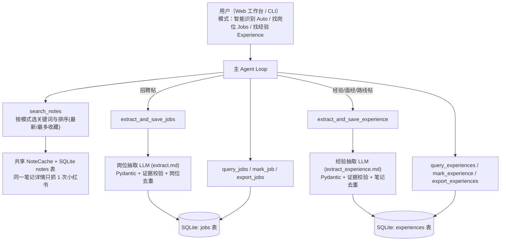

# 小红书实习情报 Agent — 双模式（岗位情报 + 经验知识）设计方案

> 配套文档：[设计文档](./design.md) · [开发方案](./development_plan.md) · [前后端方案](./web_fullstack_plan.md)
> 目标：在不污染现有招聘岗位库的前提下，将系统升级为**「岗位情报」+「经验知识」双模式架构**，统一服务于“找实习岗位”与“学 Agent 技术路线 / 做项目 / 刷面经 / 避坑”两大核心需求。

---

## 1. 为什么做对称的双模式（而不是只改一句 Prompt）

如果只在主 Agent Prompt 里加一句“也可以搜经验”，会遇到 3 个问题：
1. **数据易混杂**：学习经验帖、面经帖不是招聘岗位，不能塞进 `jobs` 表，也不能靠 `extract_and_save_jobs` 处理。
2. **上下文爆炸**：如果全靠主 LLM 调用 `get_note_detail` 读 8 篇千字面经，主上下文会迅速膨胀、费用上升、总结容易遗漏要点。
3. **干货无法沉淀复用**：聊天关掉后，辛苦搜到的 Agent 学习路线、开源项目清单、高频面试题就丢了，无法按主题筛选、标记学习进度或导出成 Markdown 复习笔记。

因此，最佳方案是沿用现有 Harness 的核心思想——**底层共享搜索/缓存/限流，业务层双管道隔离、双表存储、双知识库管理**：

| 维度 | 模式 A：岗位情报（已有） | 模式 B：经验知识（新增） |
|---|---|---|
| **典型需求** | 找广州 AI Agent / RAG 实习、2028 届内推 | 搜 Agent 学习路线、RAG 简历项目、大厂面经、避坑经验 |
| **搜索策略** | 关键词拼接 `招/招聘/内推/急招`，重时效（`半年内`） | 关键词拼接 `学习路线/面经/项目/避坑/总结`，重质量（`最多收藏`/`最多点赞`） |
| **核心抽取工具** | `extract_and_save_jobs(note)` | `extract_and_save_experience(note)` |
| **过滤规则** | 跳过 Vlog、面经、经验分享、水帖 | 跳过纯招聘广告、卖课引流、纯情绪水帖 |
| **独立存储表** | SQLite `jobs` 表 | SQLite `experiences` 表（互不污染） |
| **防编造机制** | `evidence` 原文片段 + `verify_evidence` 强校验 | 同样的 `evidence` 原文片段 + `verify_evidence` 强校验 |
| **跟进状态** | `new / interested / applied / rejected / expired` | `unread / reading / starred / archived` |
| **导出格式** | Excel（`.xlsx`，含来源超链接） | **Markdown 复习笔记（`.md`）** + Excel（`.xlsx`） |
| **Web 页面** | 岗位情报库（`/jobs`） | 经验知识库（`/experiences`） |

---

## 2. 整体架构（双管道共享底层缓存）



**关键复用点**：
- `notes` 表记录一篇笔记的原始详情 `detail_json`，新增 `exp_processed_at` 列，与现有的 `processed_at`（岗位抽取标记）分开记录。
- 如果某篇笔记（比如阶段 1 真实抓到的网易游戏 Coding Agent 面经 `#15`）之前被岗位模式拉过详情并判定为“非招聘帖”，后续经验模式再碰到它时，**直接命中本地 `notes.detail_json`，0 次额外小红书请求**即可完成面经抽取入库！

---

## 3. 数据模型与存储设计

### 3.1 Pydantic 模型（`xhs_agent/knowledge/models.py`）

```python
from datetime import datetime
from typing import Literal
from pydantic import BaseModel, Field

ExperienceCategory = Literal["roadmap", "project", "interview", "tips"]
ExperienceStatus = Literal["unread", "reading", "starred", "archived"]

class ExperienceItem(BaseModel):
    category: ExperienceCategory            # roadmap(学习路线) / project(项目实战) / interview(面经真题) / tips(求职避坑/复盘)
    topic: str                              # 核心主题，如 "AI Agent" / "RAG" / "MCP" / "LLM 面试"
    title: str                              # 提炼的干货标题（忠于原文）
    target_audience: str | None = None      # 适用人群，如 "2028届本科生" / "0实习转行"
    summary: str                            # 2–4 句核心观点总结
    key_points: list[str] = Field(default_factory=list)   # 核心要点 / 学习步骤 / 面试真题列表（3–10 条）
    tech_stack: list[str] = Field(default_factory=list)   # 涉及技术栈/框架，如 ["LangGraph", "MCP", "RAG"]
    resources: list[str] = Field(default_factory=list)    # 原文提到的教程、开源项目、论文、工具
    pitfalls: list[str] = Field(default_factory=list)     # 原文提到的避坑点或高频误区

    # 防编造字段
    evidence: str                           # 从原文连续复制的支撑片段（经 verify_evidence 强校验）
    confidence: float = Field(default=0.8, ge=0.0, le=1.0)

class ExperienceRecord(ExperienceItem):
    # 来源字段全部由代码填写，不由 LLM 生成
    id: int | None = None
    note_id: str                            # UNIQUE：笔记级去重，同一篇干货不重复入库
    source_url: str
    note_title: str | None = None
    note_author: str | None = None
    note_published_at: datetime | None = None
    liked_count: int | None = None          # 保留互动热度，方便按高赞排序
    collected_count: int | None = None
    crawled_at: datetime
    needs_image: bool = False
    status: ExperienceStatus = "unread"
```

### 3.2 SQLite 表结构变更（`xhs_agent/jobs/store.py`）

1. **`notes` 表向后兼容迁移**：
   - 检查是否已有 `exp_processed_at TEXT` 列，没有则自动 `ALTER TABLE notes ADD COLUMN exp_processed_at TEXT;`（不影响已有数据）。
2. **新增 `experiences` 表**：
   - 字段与 `ExperienceRecord` 一一对应，`note_id` 建 `UNIQUE` 索引，`category`、`topic`、`status` 建普通索引；
   - 支持分页条件查询（`category`、`topic`、`keyword`、`status`、`needs_image`、按发布时间或点赞数排序）、状态更新、删除与 facets 统计（各分类/各状态计数、热门 topic 列表）。

---

## 4. 抽取管道与业务工具设计

### 4.1 独立经验抽取提示词（`xhs_agent/prompts/extract_experience.md`）

- 使用 DeepSeek JSON 输出模式（`response_format={"type": "json_object"}`，`temperature=0.0`），输出 `{"item": ExperienceItem | null, "needs_image": bool}`。
- 严格过滤规则：
  - **排除**：纯招聘 JD、培训机构/卖课引流帖、纯情绪吐槽无技术干货的流水账 Vlog → 返回 `{"item": null, "needs_image": false}`；
  - **保留**：包含具体学习路线、技术架构、项目实现细节、真实面试题清单或明确避坑建议的干货帖；
  - **面经特殊要求**：若为面经（`category="interview"`），尽量把原文中的面试问题完整提炼进 `key_points`，不遗漏核心场景题；
  - **防编造**：绝不自行补充原文没提过的框架、课程或链接；`evidence` 必须原样摘自原文并通过 `verify_evidence()` 校验。

### 4.2 新增 4 个注册给主 LLM 的业务工具

| 工具名 | 参数 | 返回给主 LLM | 说明 |
|---|---|---|---|
| `extract_and_save_experience` | `note`（短 id） | 一行精简摘要：`status` (`ok`/`already_processed`/`not_experience`/`needs_image`)、`category`、`title`、`key_points_count`、`source_url` | 共享 `detail` 预算组，主上下文不塞入笔记全文 |
| `query_experiences` | `category`, `topic`, `keyword`, `status`, `limit` | 精简经验卡片列表（含 `id`、`title`、`summary`、`key_points`、`resources`、`source_url`） | 供主 LLM 生成学习指南汇总 |
| `mark_experience` | `exp_id`, `status` | 更新后的精简记录 | 更新学习状态（`unread`/`reading`/`starred`/`archived`） |
| `export_experiences` | 同筛选条件 + `format` (`markdown` \| `excel`) + 可选 `path` | `{path, count, format}` | 默认导出排版精美的 `.md` 学习笔记（含目录、分分类汇总、要点清单、原帖链接） |

### 4.3 双模式自适应主 Prompt（`xhs_agent/prompts/agent_system.md`）

在 System Prompt 中明确双模式路由协议：
1. **意图识别（支持显式模式约束 `auto` / `jobs` / `experience`）**：
   - 用户找实习/招聘/内推 → 执行 **岗位模式**；
   - 用户问学习路线、项目实战、面经、技术复盘、避坑 → 执行 **经验模式**；
   - 用户同时提出两类需求（例如“找广州 Agent 实习，顺便查一下大家怎么准备 Agent 面经”）→ 分别用两组关键词搜索，招聘帖走 `extract_and_save_jobs`，干货帖走 `extract_and_save_experience`，最后分栏汇总！
2. **经验模式检索规范**：
   - 拆出 2–4 个互补学习关键词（如 `"AI Agent 学习路线"`、`"Agent 开发 项目 简历"`、`"AI Agent 实习 面经"`、`"RAG Agent 避坑"`），善用 `sort_by="最多收藏"` 或 `"最多点赞"` 筛选高干货帖子；
   - 跳过纯招聘贴与卖课广告；
   - 对筛选出的 4–8 篇高赞干货直接调用 `extract_and_save_experience(note="nX")`；
   - 完成后调用 `query_experiences` 聚合知识点，输出**结构化学习指南（推荐路线 → 核心技术栈 → 实战项目建议 → 高频面试题/避坑点 → 原帖参考清单）**，按需调用 `export_experiences(format="markdown")` 导出学习笔记。

---

## 5. Web 前后端扩展设计

### 5.1 后端 API（`xhs_agent/api/routes/experiences.py`）

| 方法与路径 | 说明 |
|---|---|
| `GET /api/experiences` | 分页条件筛选（`category` / `topic` / `keyword` / `status` / `needs_image` / `sort`）+ `facets`（分类计数、状态计数、热门主题） |
| `GET /api/experiences/{exp_id}` | 获取单条完整干货记录（含全部要点、资源、避坑与防编造原文证据） |
| `PATCH /api/experiences/{exp_id}` | 更新学习状态（`unread / reading / starred / archived`） |
| `DELETE /api/experiences/{exp_id}` | 删除记录 |
| `GET /api/experiences/export?format=md\|xlsx` | 按当前筛选条件即时生成并下载 `.md` 学习笔记或 `.xlsx` 表格 |

**会话接口扩展（向后兼容）**：
- `POST /api/sessions` 与 `POST /api/sessions/{id}/messages` 新增可选参数 `mode: "auto" | "jobs" | "experience"`（默认 `"auto"`）；
- SSE `turn_complete` 事件新增 `newly_saved_experiences: ExperienceRecord[]`；
- `GET /api/system/status` 与 `GET /api/stats/overview` 增加 `db_experiences_count`。

### 5.2 前端界面扩展（`web/src/`）

1. **左侧导航栏**（3 项 → 4 项）：
   - `智能检索工作台`
   - `岗位情报库`（带岗位数徽章）
   - **`经验知识库`**（新增，带经验条数徽章）
   - `监控与 Trace`
2. **智能检索工作台增强（`WorkspacePage.tsx`）**：
   - 输入框上方增加**模式切换胶囊**：`智能识别` / `💼 找岗位` / `📚 找经验`；
   - 空白启动态同时提供岗位与学习经验快捷提示（如「帮我搜索 AI Agent + RAG 实习学习路线、推荐实战项目和避坑经验，整理并导出 Markdown 笔记」「帮我搜集 2028 届 AI Agent 开发高频面经」）；
   - 助手回答下方支持展示**本轮新入库经验卡片**（可一键收藏或跳原帖）；
   - 右侧 `ExecutionTimeline` 增加 `extract_and_save_experience` / `query_experiences` / `export_experiences` / `mark_experience` 的专属图标与中文标签。
3. **新增「经验知识库」页面（`web/src/pages/ExperiencesPage.tsx` + `ExperienceDetailDrawer.tsx`）**：
   - 顶部分类 Tab：`全部` / `🗺️ 学习路线` / `🛠️ 项目实战` / `🎯 面试真题` / `⚠️ 避坑复盘`；
   - 筛选条：关键词搜索、学习状态下拉（`未读/在学/已收藏/已归档`）、排序（最新发布 / 最多点赞）、一键下载 **「导出 Markdown 笔记」** 与 **「导出 Excel」**；
   - 卡片网格展示：干货标题、分类与状态徽章、核心摘要、前 3 条要点预览、技术栈标签、点赞/收藏数；
   - 点击卡片打开右侧抽屉：展示完整 `key_points` 清单、`resources`、`pitfalls`、高亮防编造 `evidence`、原帖链接与状态切换。

---

## 6. 分阶段实施计划与验收标准（D1 – D3）

| 阶段 | 名称 | 核心任务 | 验收标准 | 预估 |
|---|---|---|---|---|
| **D1** | 经验抽取管道与存储层 | 实现 `xhs_agent/knowledge/`（`models.py`、`extract.py`、`tools.py`、`prompts/extract_experience.md`）；扩展 `JobStore` 增加 `experiences` 表与 `notes.exp_processed_at`；编写离线单元测试（用阶段 1 真实录制的 `#15` 网易面经与 Vlog 样本验证） | `pytest` 覆盖经验抽取、证据校验丢弃编造、非干货过滤、笔记级去重、`.md` 与 `.xlsx` 导出，全绿通过 | 0.5 天 |
| **D2** | 双模式 Harness + 后端 API | 升级 `agent_system.md`、`runtime.py`（注册 4 个经验工具 + `mode` 参数）、`task_manager.py`（SSE 返回 `newly_saved_experiences`）；新增 `/api/experiences/*` 路由与 API 离线集成测试 | `pytest` 覆盖双模式工具注册、`auto/jobs/experience` 路由、`/api/experiences` 筛选/改状态/导出 `.md` 与 `.xlsx`、SSE 推送 | 0.5 天 |
| **D3** | 前端经验知识库 + 工作台双模式 + 真机验证 | 实现 `ExperiencesPage.tsx`、`ExperienceDetailDrawer.tsx`，升级 `WorkspacePage.tsx` 模式切换与经验卡片、`App.tsx` 导航与 `ExecutionTimeline`；构建 `web/dist`；真机跑通一次“搜索 Agent 学习经验 → 入库经验库 → 导出 Markdown 笔记”，打标签 `dual-mode-v1` | `npm run build` 零错；全量 `pytest` 通过；在 `http://127.0.0.1:8000` 可完整体验岗位与经验双模式且两库互不污染 | 0.5–1 天 |
