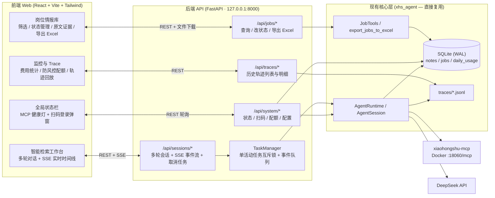

# 小红书实习情报 Agent — 前后端一体化设计方案

> 配套文档：[设计文档](./design.md) · [分阶段开发方案](./development_plan.md)
> 适用范围：在已完成阶段 0–5（`phase-5`）的基础上，为现有 Python Harness 补齐可视化 Web 前后端（不涉及阶段 6 高级能力）。

---

## 1. 设计目标与约束

把当前命令行形态的 `xhs_agent` 升级为本地可开箱使用的 **Web 工作台**，重点解决 CLI 下的 4 个实际痛点：

1. **长耗时任务过程可视化**：单次搜索 + 抽取因防风控间隔（3–8 秒/次）耗时约 30–120 秒，前端需要像 AI 编程助手一样实时展示 Agent 每一步调用了什么工具、筛掉了哪些帖、新增了几条岗位。
2. **岗位库可视化管理**：直接在网页中按城市/届别/关键词/状态筛选岗位，行内一键切换 `感兴趣 / 已投递 / 已拒绝`，查看原文证据（`evidence`），一键下载筛选后的 Excel。
3. **网页内一键扫码登录**：展示 MCP 连通性与小红书登录状态，掉登录时直接在页面弹窗中渲染二维码扫码，无需切终端找图片。
4. **配额与费用透明可控**：实时展示当日小红书搜索/详情防风控配额消耗、DeepSeek 缓存命中率、历史 Trace 回放与人民币预估费用。

### 关键架构约束（由底层机制决定）

- **零重写现有 Harness**：后端直接复用现有的 `AgentRuntime`、`AgentSession`、`JobStore`、`JobTools`、`export_jobs_to_excel` 与 `TraceLogger`，只做薄层 HTTP/SSE 封装。
- **单浏览器串行互斥**：`xiaohongshu-mcp` 容器内只有 1 个 Chrome 实例，**同一时刻只允许执行 1 个涉及小红书抓取的 Agent 任务**；但岗位查询、改状态、导出 Excel、查看 Trace 等本地 SQLite/文件操作可随时并发执行。
- **仅限本地访问**：默认绑定 `127.0.0.1:8000`，不暴露公网，不增加账号泄露风险。

---

## 2. 技术选型与整体架构

| 层 | 选型 | 选型理由 |
|---|---|---|
| **后端框架** | **FastAPI + Uvicorn** | 与现有纯异步 `asyncio` 的 `MCPClient` / `DeepSeekClient` / `AgentLoop` 共享同一事件循环；依赖极轻（`uvicorn`、`starlette`、`pydantic` 已在当前 `.venv` 中，仅需新增 `fastapi`） |
| **实时推送** | **SSE（Server-Sent Events）** | 单向服务端推流（Agent 执行事件 → 前端），比 WebSocket 简单稳定、天然兼容 HTTP 代理、断线易重连；直接对接现有 `AgentLoop.run_turn(..., on_event=...)` |
| **前端框架** | **React 19 + TypeScript + Vite + Tailwind CSS + Lucide Icons** | 相比 Streamlit/Gradio，更能精细控制流式工具时间线、复杂多条件筛选表格、原文证据抽屉和二维码扫码弹窗；打包产物极小 |
| **持久化** | **复用现有 SQLite (`data/xhs_jobs.db`)** | 开启 `WAL` 模式支持读写并发；新增 `web_sessions` / `web_messages`（可选）记录网页多轮对话历史，零外部数据库运维负担 |
| **托管方式** | **开发态双端热更 / 生产态 FastAPI 单端口托管** | `web/` 构建后的 `dist/` 由 FastAPI `StaticFiles` 直接提供，最终只需一条命令 `uv run python -m xhs_agent.api` 即可打开浏览器使用 |

### 整体架构图



---

## 3. 后端设计（`xhs_agent/api/`）

### 3.1 目录结构

```text
xhs_agent/
├── api/
│   ├── __init__.py
│   ├── __main__.py        # 启动入口：uv run python -m xhs_agent.api
│   ├── app.py             # FastAPI 实例、lifespan 生命周期、CORS、静态资源托管
│   ├── schemas.py         # 请求/响应 Pydantic Schema
│   ├── task_manager.py    # 多轮会话表、单活动任务锁、SSE 事件广播队列、任务取消
│   └── routes/
│       ├── system.py      # 健康检查、登录态、二维码、每日配额
│       ├── sessions.py    # 创建会话、发送消息、SSE 流、取消执行
│       ├── jobs.py        # 岗位分页查询、单条详情、状态修改、Excel 下载
│       └── traces.py      # 历史 Trace 列表、单会话事件详情、累计费用统计
```

### 3.2 生命周期与并发控制

1. **应用启动（`lifespan`）**：
   - 打开 `JobStore(db_path)`（开启 `PRAGMA journal_mode=WAL; PRAGMA busy_timeout=5000;`）；
   - 尝试建立 `MCPClient` 与 `XhsAdapter` 连接；**注意与 CLI 的区别**：Web 后端在 MCP 未登录或暂时未启动时**不应直接崩溃退出**，而是进入降级态（仍可浏览已有岗位库、导出 Excel、查看 Trace，并在前端顶部提示“未登录小红书，点击扫码”）。
2. **`TaskManager` 单活动任务调度**：
   - 维护 `sessions: dict[str, ManagedSession]`（封装现有 `AgentSession` + 运行态状态 `idle | running` + 历史事件缓冲 + 活跃订阅者队列）。
   - 维护全局 `_active_run_lock`：同一时刻只允许 1 个需要访问 MCP 的对话轮次在跑；如果已有任务在执行，新发请求返回 `409 Conflict`（前端禁用发送按钮并提示“当前有任务运行中”）。
   - 将 `AgentLoop.run_turn(..., on_event=...)` 的同步回调桥接到 `asyncio.Queue`，实现零延迟 SSE 推送；同时保留本次轮次的事件历史，避免用户刷新页面后丢失进度。
   - **支持中止任务**：提供 `POST /api/sessions/{id}/cancel`，在 `AgentLoop` 每步工具执行前检查 `cancel_event.is_set()`，收到取消信号后优雅停止当前轮次并保存已入库数据，绝不破坏 SQLite 状态。

### 3.3 完整 API 接口设计

#### A. 系统状态与扫码登录（`/api/system`）

| 方法与路径 | 说明 | 核心返回字段 |
|---|---|---|
| `GET /api/system/status` | 获取系统健康态与小红书登录状态 | `mcp_connected`, `logged_in`, `login_message`, `db_jobs_count`, `active_session_id`, `daily_usage: {search: {used, limit}, detail: {used, limit}}`, `config_summary` |
| `POST /api/system/login/qrcode` | 调用 MCP `get_login_qrcode` 拉取登录二维码 | `image_base64` (`data:image/png;base64,...`), `hint_text`, `expires_hint` |
| `POST /api/system/mcp/reconnect` | 手动重连 MCP Server 并重新执行白名单预检 | `mcp_connected`, `validated_tools`, `logged_in` |

> 注：为保持“写操作永不注册给 LLM”的安全红线，`get_login_qrcode` 仅由 `system.py` 在用户显式点击前端“扫码登录”按钮时调用，绝不加入 `ToolRegistry`。

#### B. 会话与流式执行（`/api/sessions`）

| 方法与路径 | 说明 | 请求 / 返回 |
|---|---|---|
| `POST /api/sessions` | 创建一个新的多轮对话会话 | 请求可选 `{max_search, max_detail, max_steps}` → 返回 `{session_id, created_at}` |
| `GET /api/sessions` | 获取当前内存/历史会话摘要列表 | `[{session_id, turns, status, total_cost_cny, last_message, trace_path}]` |
| `POST /api/sessions/{id}/messages` | 向指定会话发送一条用户消息并后台启动 Agent Loop | 请求 `{content: str, max_search?: int, max_detail?: int}` → 返回 `202 Accepted {run_id, session_id, turn}` |
| `GET /api/sessions/{id}/events` | **SSE 实时事件流**（`text/event-stream`） | 按顺序推送事件（支持 `?run_id=...` 断线重放当前轮次已产生事件） |
| `POST /api/sessions/{id}/cancel` | 请求取消当前运行中的轮次 | `{cancelled: true}` |

**SSE 事件协议规范（与现有 `AgentLoop` 事件 1:1 映射）：**

```text
event: turn_start
data: {"run_id": "r_01", "turn": 1, "user_input": "帮我找广州 AI Agent 实习"}

event: tool_call
data: {"step": 1, "tool": "search_notes", "args": {"keyword": "广州 AI Agent 实习 招"}}

event: tool_result
data: {"step": 1, "tool": "search_notes", "ok": true, "duration_ms": 16200, "summary": "keyword='广州 AI Agent 实习 招' count=20"}

event: llm_response
data: {"step": 2, "duration_ms": 2300, "usage": {"total_tokens": 3400, "cache_hit_tokens": 1800}}

event: budget_exhausted
data: {"step": 6, "reason": "工具已达本次任务调用上限"}

event: turn_complete
data: {
  "turn": 1,
  "answer": "### 广州 AI Agent 实习汇总...",
  "stop_reason": "completed",
  "steps": 5,
  "total_llm_calls": 9,
  "total_usage": {"prompt_tokens": 26361, "cache_hit_tokens": 19968, "completion_tokens": 1477, "total_tokens": 27838},
  "cost": {"currency": "CNY", "total_cost": 0.0212, "cache_savings": 0.0359},
  "tool_calls": {"search_notes": 2, "extract_and_save_jobs": 4, "query_jobs": 1},
  "newly_saved_jobs": [...]
}

event: error
data: {"message": "..."}
```

#### C. 岗位情报库与导出（`/api/jobs`）

| 方法与路径 | 说明 | 参数 / 返回 |
|---|---|---|
| `GET /api/jobs` | 分页条件查询岗位库 | Query: `city`, `keyword`, `graduation_year`, `since`, `status`, `only_fresh` (60天内), `needs_image`, `page`, `page_size` → 返回 `{total, items: JobRecord[], facets: {cities, status_counts}}` |
| `GET /api/jobs/{job_id}` | 获取单条岗位完整详情（含 `evidence`、`extra_sources`、关联笔记标题） | `JobRecord` |
| `PATCH /api/jobs/{job_id}` | 更新岗位业务跟进状态 | 请求 `{status: "new" | "interested" | "applied" | "rejected" | "expired"}` → 返回更新后的 `JobRecord` |
| `DELETE /api/jobs/{job_id}` | 删除误收或无用岗位（可选） | `{deleted: true}` |
| `GET /api/jobs/export` | 按当前筛选条件实时生成并下载 `.xlsx` | 同 `GET /api/jobs` 筛选参数 → 返回 `application/vnd.openxmlformats-officedocument.spreadsheetml.sheet` 文件流（直接复用 `export_jobs_to_excel`） |

#### D. 运行轨迹与成本统计（`/api/traces`）

| 方法与路径 | 说明 | 核心返回 |
|---|---|---|
| `GET /api/traces` | 扫描 `traces/*.jsonl` 返回历史会话统计列表 | `[{session_id, started_at, task, steps, llm_calls, total_tokens, cache_hit_rate, total_cost_cny, stop_reason}]` |
| `GET /api/traces/{session_id}` | 返回单个会话的完整 JSONL 事件数组（供前端时间线回放） | `{session_id, events: [...]}` |
| `GET /api/stats/overview` | 总览指标卡片数据 | `{total_jobs, status_counts, total_sessions, total_cost_cny, avg_cache_hit_rate, daily_usage}` |

### 3.4 对现有核心代码的极小改造点

1. `xhs_agent/jobs/store.py`：
   - 启用 `PRAGMA journal_mode=WAL` 与 `check_same_thread=False` + 细粒度写锁（适配 FastAPI 异步/线程池调用）；
   - 补充 `query_jobs_paginated(...)`（返回 `total`、状态分布 `status_counts`、城市列表 `cities`）与 `delete_job(job_id)`。
2. `xhs_agent/harness/loop.py`：
   - `run_turn()` 增加可选参数 `cancel_event: asyncio.Event | None = None`，每步开始和工具执行前检查取消标志。
3. `xhs_agent/xhs/adapter.py`：
   - 新增受限方法 `get_login_qrcode()`（仅用于前端扫码弹窗，**不加入 `ALLOWED_MCP_TOOLS` 常规业务白名单**）。

---

## 4. 前端设计（`web/`）

### 4.1 布局与信息架构

采用**左侧窄导航栏 + 顶部全局状态栏 + 主内容区**的桌面优先工作台布局（兼顾窄屏折叠）：

- **顶部全局状态栏（始终可见）**：
  - **MCP 状态灯**：绿色「已连接 · 已登录（`if`）」 / 黄色「未登录 → 点击扫码」 / 红色「MCP 离线 → 重试连接」
  - **今日防风控配额胶囊**：`搜索 2/50` · `详情 4/150`（超过 80% 变黄预警，100% 变红拦截提示）
  - **当前运行状态**：有任务运行时显示脉冲指示器 + 一键跳回工作台 / 中止按钮

- **三大主视图**：

#### 视图 1：智能检索工作台（`/`）
采用**左右分栏**：
- **左栏（对话交互区，占 ~62%）**：
  - 空白启动态提供 3–4 个快捷需求卡片（如「广州 AI Agent / RAG · 2028 届」「深圳大模型开发日常实习」「查询本地库中未投递岗位」）。
  - 消息流支持 Markdown 渲染（岗位链接直接可点击新标签打开小红书原帖）、单轮末尾附带**精简费用徽章**（`5 步 · 缓存命中 76% · ¥0.021`）。
  - 输入区下方提供轻量参数开关：`最多搜索次数 (1–6)`、`最多抽取篇数 (1–20)`，以及「新建会话」按钮。
- **右栏（实时执行时间线，占 ~38%，可收起）**：
  - 订阅 SSE，以时间线卡片实时展示每一步：
    - `search_notes("广州 AI Agent 实习 招")` → 绿色徽章 `20 篇 · 16.0s`
    - `extract_and_save_jobs("n1")` → 蓝色徽章 `新增 1 条：腾讯-AI Agent产品实习生`
    - `extract_and_save_jobs("n7")` → 灰色徽章 `非招聘帖，已跳过`
    - 遇到防风控等待时友好提示「防风控串行间隔中（3–8s）…」，消除用户等待焦虑。
  - 底部固定展示**本轮新入库岗位快捷卡片**，支持直接点「⭐ 感兴趣」或「导出本批 Excel」。

#### 视图 2：岗位情报库（`/jobs`）
- **顶部统计条 + 筛选工具栏**：
  - 状态快捷 Tab：`全部` / `新发现 (new)` / `感兴趣 (interested)` / `已投递 (applied)` / `已拒绝 (rejected)` / `已过期 (expired)`，每个 Tab 带实时计数徽章。
  - 搜索框（匹配公司/岗位/技能/标题）+ 城市下拉 + 届别筛选 + 勾选框「隐藏超过 60 天」「仅看需看图 (`needs_image`)」。
  - 右侧主按钮：**「导出当前筛选为 Excel」**（直连 `GET /api/jobs/export?...` 触发下载）。
- **岗位数据表（支持点击行展开右侧抽屉）**：
  - 关键列：公司/团队、岗位名称、城市、届别/学历、出勤/时长、薪资、投递方式、发布时间、状态（行内下拉即时 `PATCH` 保存，带乐观更新与 Toast 提示）、操作（打开原帖链接）。
  - 醒目标签：
    - `needs_image=true` → 琥珀色徽章「📷 详情见图」
    - `maybe_expired=true` → 灰色/橙色徽章「⏱ 超过 60 天」
    - `extra_sources.length > 0` → 蓝色徽章「+N 个转发来源」
  - **右侧详情抽屉**：展示完整技能标签、全部转发来源链接、**高亮展示防编造原文证据（`evidence`）**，让用户一眼确认信息真实无编造。

#### 视图 3：监控与 Trace 回放（`/traces`）
- **顶部 KPI 卡片**：累计收集岗位数、累计会话次数、累计估算费用（CNY）与缓存省下费用、平均 DeepSeek 缓存命中率、今日防风控配额进度条。
- **历史会话列表 + 事件回放器**：
  - 左侧列表显示每次运行（包括 CLI 跑出来的旧 `traces/*.jsonl` 也能直接看到！）。
  - 右侧时间线展开每一步 `llm_request` / `tool_call` / `tool_result` 的耗时、参数、返回摘要与 Token 消耗，辅助调优 Prompt 和排查异常。

#### 全局弹窗：小红书扫码登录弹窗
- 点击顶部「未登录」按钮触发 `POST /api/system/login/qrcode`，弹窗居中显示二维码图片与倒计时提示；
- 前端每 3 秒轮询 `GET /api/system/status`，检测到 `logged_in: true` 后自动关闭弹窗、刷新状态灯并弹出“登录成功”提示；二维码超时支持一键刷新。

### 4.2 前端目录结构

```text
web/
├── index.html
├── package.json
├── vite.config.ts           # 开发代理 /api -> http://127.0.0.1:8000
├── tsconfig.json
└── src/
    ├── main.tsx
    ├── App.tsx              # 路由/视图切换 + 全局状态栏 + 扫码弹窗
    ├── api/
    │   ├── client.ts        # 强类型 REST 封装
    │   ├── sse.ts           # SSE 订阅与事件解析封装
    │   └── types.ts         # 与后端 schemas.py 对齐的 TS 类型
    ├── components/
    │   ├── TopStatusBar.tsx # MCP 状态灯、配额进度、扫码入口
    │   ├── LoginQrModal.tsx # 二维码展示 + 3s 轮询登录
    │   ├── ExecutionTimeline.tsx # SSE 工具调用实时时间线
    │   ├── JobDetailDrawer.tsx   # 岗位详情与原文 evidence 抽屉
    │   └── StatusBadge.tsx       # 岗位状态下拉切换组件
    └── pages/
        ├── WorkspacePage.tsx     # 视图 1：智能检索工作台
        ├── JobsPage.tsx          # 视图 2：岗位情报库
        └── TracesPage.tsx        # 视图 3：监控与 Trace 回放
```

---

## 5. 开发与运行方式

### 5.1 本地开发模式（前后端热重载）

```powershell
# 终端 1：确保小红书 MCP 容器运行
docker compose up -d

# 终端 2：启动 FastAPI 后端（自动重载）
uv run uvicorn xhs_agent.api.app:app --host 127.0.0.1 --port 8000 --reload

# 终端 3：启动 Vite 前端（默认 http://localhost:5173，/api 自动代理到 8000）
cd web && npm run dev
```

### 5.2 一体化日常使用模式（单进程单端口）

```powershell
# 构建前端静态资源到 web/dist
cd web && npm run build

# 启动后端，自动托管 web/dist，浏览器访问 http://127.0.0.1:8000
uv run python -m xhs_agent.api
```

---

## 6. 分阶段实施计划与验收标准

延续项目“小步快跑、每阶段可独立验收”的节奏，将前后端拆为 **4 个子阶段（W1 – W4）**：

| 阶段 | 名称 | 核心任务 | 验收标准 | 预估 |
|---|---|---|---|---|
| **W1** | 后端 REST 与基础改造 | `JobStore` 开启 WAL + 分页/聚合查询；`adapter.get_login_qrcode()`；搭建 `xhs_agent/api/`，完成 `/api/system/*`、`/api/jobs/*`（含 Excel 下载）、`/api/traces/*` 与对应 pytest `TestClient` 离线单测 | `pytest` 全部通过（Mock MCP + 临时 SQLite）；Swagger UI (`/docs`) 可查岗位、改状态、下载真实 `.xlsx` | 0.5–1 天 |
| **W2** | 后端异步会话与 SSE 流 | `AgentLoop` 支持 `cancel_event`；实现 `TaskManager`（单活动任务锁 + 事件缓冲 + 断线重放）；完成 `/api/sessions/*` 的发送消息、SSE 实时推送与取消接口 + 模拟 LLM SSE 集成测试 | `pytest` 覆盖并发 `409` 互斥、SSE 事件完整性、任务中途取消；`curl -N` 可看到实时 SSE 事件流 | 0.5–1 天 |
| **W3** | 前端骨架 + 岗位库 + 登录弹窗 | 初始化 `web/`（React + Vite + TS + Tailwind）；完成顶部状态栏（MCP 灯 + 配额 + 扫码登录弹窗）、岗位情报库页面（多条件筛选、行内改状态、原文证据抽屉、一键导出 Excel） | 前端 `npm run build` 无错；真实数据可在网页筛选、切换状态持久化到 SQLite 并成功下载 `.xlsx` | 1 天 |
| **W4** | 前端工作台（SSE）+ Trace 面板 + 一体化打包 | 实现智能检索工作台（多轮对话 + 右侧实时工具时间线 + 费用徽章 + 中止按钮）、Trace 回放与成本监控页；配置 FastAPI 托管 `web/dist`；全流程联调并打 tag `web-v1` | 单命令 `uv run python -m xhs_agent.api` 打开 `http://127.0.0.1:8000`，跑通“扫码检查 → 提问检索 → 实时看工具流 → 岗位库标记状态 → 下载 Excel → Trace 回放”全闭环 | 1–1.5 天 |

---

## 7. 安全与工程注意事项

1. **绑定本机环回地址**：默认仅监听 `127.0.0.1:8000`，严禁在无鉴权情况下绑定 `0.0.0.0` 暴露到局域网/公网。
2. **绝不破坏防风控铁律**：前端哪怕连点发送或开启多个标签页，后端 `TaskManager` 与 `RateLimiter` 仍强制单任务互斥 + 串行 + 3–8 秒随机间隔 + 每日配额上限。
3. **写操作隔离不变**：MCP 写工具（发帖、评论、点赞、收藏、删 Cookie）在后端依然永久禁止；前端只允许操作本地 SQLite 的岗位状态与导出文件。
4. **降级容错**：即使 `xiaohongshu-mcp` 容器未启动，后端也能正常启动，用户依旧可以在网页里浏览历史岗位库、修改跟进状态、导出 Excel 和回看历史 Trace。
